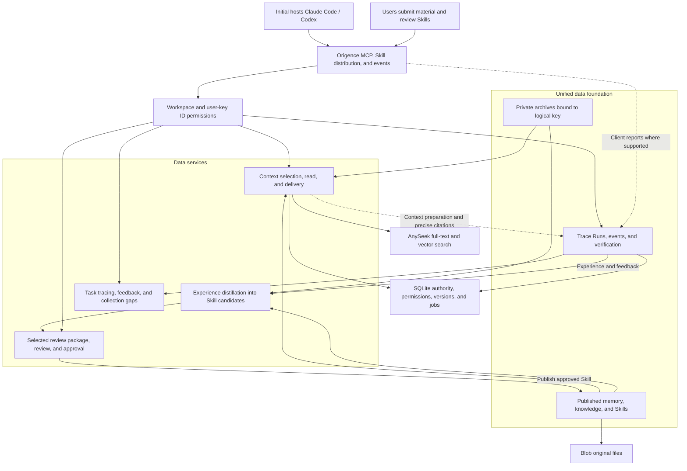
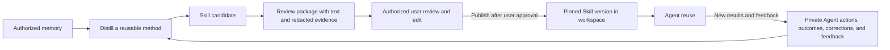

# Origence · Unified data foundation for AI agents

**English** · [简体中文](agent-data-foundation.md)

The first-release contract baseline is v0.8 (2026-11-16). This document describes the target architecture and initial acceptance.

See the [roadmap](../ROADMAP.en.md) for product evolution, [platform design](current-implementation.en.md) for implementation, [API](../API.en.md) for interfaces, and [STATUS](../STATUS.en.md) for progress.

## 1. Positioning and first-release scope

**Origence is the unified data foundation for AI agents, covering memory, knowledge, Skills, and Trace.** Context assembly selects data the agent is authorized to use for the task. Trace records execution evidence in Runs for review and experience distillation.

The first release targets enterprise engineering and business teams, piloting on intranets through local **Claude Code and Codex** CLIs. Users select evidence from memory and execution experience to form reviewable Skill candidates. Publication requires approval by a user with publishing rights. Session archives are private to their logical keys. Each logical key binds one session within a workspace. That key owns the Runs it creates, and workspace administrators can read their recorded traces. Memory, knowledge, and Skills are published in their workspace and reused under that workspace's permissions. Knowledge copies approved by the deployment administrator can be shared through the global space. Sessions support platform archiving and authorized reads, without restoring client work environments.

### Workspace keys and deployment-wide knowledge

- A workspace is the identity for ordinary access. It has one active key for Agents and the console. The key grants business reads and writes in that workspace. Rotation preserves the workspace and archive. The administrator uses a separate account to inspect sessions and Runs and perform operations in the selected workspace.
- Conversation turns are archived and retained. A workspace key can delete an extracted memory. Extraction uses the existing durable worker and publishes back to the source workspace. Once deleted, a memory must stay deleted if the same source is retried or reprocessed.
- Each deployment has one shared knowledge space. A workspace submits a fixed version of its knowledge for administrators to approve, reject, or withdraw. Only approved, live versions enter shared recall. A published version identifies its evidence, and private attachments and turns retain their source authorization.
- Recall includes local memory and knowledge plus live shared knowledge. Results identify scope and version. Extracted memories, private knowledge changes, and Skills are written to their original workspace.

Single-key workspaces, conversation retention and automatic extraction, scoped administrator operations, and shared knowledge moderation and recall are implemented. Shared copies have independent publication IDs. Approval revalidates the original version. The deployment administrator can withdraw an approved copy. Legacy workspaces still have multi-key endpoints during this transition.

## 2. Overall architecture

The diagram shows the target. Solid arrows represent business calls or data dependencies, and dashed arrows observation evidence. Event ingestion and reads check permissions. The host owns model calls, task orchestration, and tool execution. AnySeek is the sole target path for full-text and vector retrieval. SQLite holds business authority, while Blob holds original files.

## 3. Core data and context

| Type | Content |
| --- | --- |
| Memory | Facts, preferences, confirmed decisions, and experiences with subject, project, and applicability conditions |
| Knowledge | Enterprise documents, standards, interface definitions, product rules, and authorized business materials |
| Skill | Instructions, steps, procedures, templates, and references distilled from memory and Agent experience |
| Trace | Run-organized preparation records, Skill load and tool usage reports, task outcomes, feedback, external verification, and capture gaps |

Record task status in explicitly submitted turns, task summaries, or event reports. Run artifact reports keep external artifact IDs and digests. Uploaded originals and published Skill packages each have a dedicated read path. Published data uses exact version and source references. Observation and report records retain reporter and time. Source authorization must cover the sharing scope.

### Ownership and isolation

| Scope | Data and access |
| --- | --- |
| Private records | Submitted turns and feedback, Run replay snapshots, and unpublished candidates, isolated by logical key |
| Published memory, knowledge, and Skills | Available to authorized users and agents in the workspace |

A key belongs to its issuing workspace. The workspace header checks that binding. Each workspace and logical key pair maps to one `session_id`. Credentials and logical identity are managed separately. Plaintext keys are not storage identities. New independent keys create independent sessions. Explicitly authorized rotation retains the logical key and session. Usernames do not merge sessions automatically. Revocation blocks corresponding access. Session history, published memory, knowledge, and Skills, and source withdrawals follow their own lifecycles and are not removed on credential revocation. Claude Code and Codex with the same logical key and workspace access the same Origence archive. Use separate workspaces for isolated Agent archives. One session can contain multiple tasks and Runs. Ownership is derived from server authentication and cannot be changed by passing another session ID. Private endpoints and context assembly verify logical ownership and current permissions. Authorized reviewers see only expressly disclosed content in a selected review package. `GET /v1/session` returns the server-resolved `{workspace_id,key_id,session_id}`. The administrator rotates the selected workspace key through `POST /admin/deployment/workspaces/{id}/keys/rotate`. Rotation preserves logical ownership and immediately invalidates the old credential. See the [API](../API.en.md#identity-and-credential-management) for legacy key operations. Explicit SessionTurn routes still require writer and also match the current key's session. Read permissions and ownership are separate. The platform preserves submitted records and provides queries without syncing or restoring client chats, context windows, tool/process/environment state, or replaying actions.

Publishing memory, knowledge, or Skills from private records requires selecting the text to share and preserving controlled source references. The original session and trace stay private. Publication requires workspace write access and authorization to read and disclose the material. Skills in a single-key workspace require administrator approval. Candidates stay private, and the review surface shows only the selected packet. A review package separates proposed artifacts (body, manifest, references) from necessary redacted evidence. Approval binds exact revision, all artifact digests, evidence digest, and target workspace/version/scope. Only approved manifest artifacts are published, while review evidence is private by default. Changing any bound item requires new review. Recheck permissions and sources before publication. Share only approved content and retain original session and citation privacy.

`EvidenceBundle` assembles memory, knowledge, and Learning by task, permission, and budget. Callers may include authorized archive turns. Preparation records exact references, gaps, and truncation. [Context assembly contract](../contracts/evidence-bundle.md)

Hosts obtain valid published packages from dedicated Skill download or export routes and load them by their own mechanism. Run load events are client reports. Candidates use a dedicated user review path.

## 4. How Skills are distilled from experience

Agents or the platform identify goals, preconditions, parameters, steps, checkpoints, and verification methods from authorized memory and recorded execution. Preserve failures, limits, and evidence gaps. One self-reported success does not establish reliability. In the first release, users select the basis and initiate candidates. See the [roadmap](../ROADMAP.en.md#milestones) for exploration of automatic proposals.

Readable candidate details should let users review the following.

| Area | What the user sees |
| --- | --- |
| Method | Problem, approach, inputs/outputs, checks, and verification steps |
| Basis | Supporting memory versions, execution records, tools and results, feedback, and unproven parts |
| Limits | Conditions, failures or counterexamples, and unverified situations |
| Changes | Differences from the published version, rationale, and review history |

Users can edit or reject candidates, or publish them as a new Skill or version. Published versions retain their evidence and history. Candidates inherit private input scopes. An authorized submitter selects the content and redacted evidence for review. **In a single-key workspace, the administrator approves, and the administrator or candidate owner can then explicitly publish the Skill.** Approval binds the selected package and destination. The server generates artifacts from the approved contents exactly. A publication is immutable `SKILL.md`, manifest, and reference files with version, digests, supporting sources, and review decision. The two adapters distribute and load them. New experience produces later candidates without deleting history. The first release includes text instructions, controlled references, and allowlisted metadata. The publisher validates package contents and allowed client fields, rejecting tool preauthorization, hooks, dynamic commands, and executable scripts. Credentials are excluded. Sharing approval does not authorize real actions. Existing host and business-tool permission and approval rules still govern execution. Managed installation and load lists are isolated by workspace. Withdrawal blocks later distribution and managed loading, without immediate recall of offline or already exported copies.

## 5. Trace and execution evidence

Trace links task summaries, preparation, Skill versions, tools, outcomes, feedback, and coverage through **Run**. Runs and events are isolated under the session's logical key. Authorized results or experiences can be published separately to the workspace.

| Evidence source | What it records |
| --- | --- |
| Origence server | Context preparation for a specified Run, exact references, diagnostics, and capture boundaries |
| Client adapter | Observed Skill loads, tools, outcomes, artifact references, and gaps according to its capabilities |
| User or test | Its own task feedback and results |
| Run owner | Transcribed external verification of an exact Run prefix, with claimed provenance |

Each event retains Run identity, reporter, time, and a stable event ID. Duplicate reports are idempotent. Server receipts, client reports, and external verification retain separate provenance. Skill approval and publication decisions are stored with review records.

**MCP can observe only requests that pass through it.** Unreported client activities remain unknown or collection gaps. The first release links context, Skills, tools, and outcomes in a readable task trace. Retain references, required status, and redacted summaries by default. Credentials are excluded from context and observations.

## 6. Origence and AnySeek responsibilities

| Work | Origence | AnySeek |
| --- | --- | --- |
| Data preparation | Accept material, keep originals, parse/chunk, and generate query and document vectors | Store text, vectors, and retrieval metadata and maintain indexes |
| Retrieval | Derive authorization scope, issue text/vector queries, check sources and versions, assemble references | Match text, search vector similarity, and rank candidates |
| Content, context, and Trace | Content lifecycle, experience distillation, Skill review/publication, context assembly, and execution evidence | Preserve published retrieval text and provide candidates |
| Persistence | SQLite stores permissions, version metadata, Skill packages, Trace, and durable jobs. Blob preserves original files. | Persist published text, summaries, and indexes by stable Record identity |

Origence selects and pins embedding model/profile and dimension. AnySeek performs vector search. Retrieval metadata contains full workspace, content item and source versions, and generation. Candidate filters and final authoritative checks agree. Private material is excluded from workspace-wide retrieval by default. Owner key and session are also verified when searching or reading it. The local host opens a disk Catalog through the AnySeek SDK. In standalone deployment, Origence holds the AnySeek URL and service credential. Both modes derive namespace and collection from authenticated Scope. Standalone mode sends tenant UUID as `X-AnySeek-Tenant`. Each workspace uses a separate `ws_<无连字符 workspace UUID>` collection (hyphens removed), initialized on first use with a fixed schema. Startup checks published collections and rejects missing or incompatible configurations. Storage isolation does not replace user authorization, private session checks, or source/version checks. Revocation or source withdrawal blocks future reads and distribution before index cleanup. Snapshots and Skills cannot bypass it. Dependency failure returns unavailable without pretending retrieval is empty.

Reuse the existing publication ledger, single durable Worker, original-plan recovery, and source locators. Model and index I/O stay outside transactions. There is no second full-text or vector engine. Build dependencies and deployment follow the unified AnySeek boundary.

## 7. Implementation order and acceptance

| Order | Delivery | Acceptance |
| --- | --- | --- |
| 1. Unified retrieval and both clients | AnySeek text/vector integration, logical key to archive binding, and retrieval isolation between workspaces | Same key reads the same archive across clients, separate keys are isolated, authorized rotation retains access, and workspace retrieval returns valid citations |
| 2. Skills from experience | Use memory and execution evidence to create candidates and let users review, edit, and publish | One engineering and one business Skill have traceable evidence, are published by authorized approval, and can be reused in both clients |
| 3. Trace and task verification | Pin context list and associate Skills, observable tools, outcomes, and feedback | Real task links all collected evidence readably and explicitly shows gaps |

Add Run and result recording through integration for Skill distillation. Step 3 completes the unified tracing experience.

Each step also verifies isolation, source update and withdrawal, precise version references, retries, and reopen recovery. Direct reads, Bundle/search, artifact access, and source links enforce private data access. Recorded Run traces are available to the owner and workspace administrators. Skills also check invalidation of approval after editing and denial of reads or distribution after support invalidation. Verify unauthorized submission/review denial, approval invalidation after digest or destination changes, rejection of execution extensions, and isolation of local loading across workspaces. Session acceptance covers archive and querying, authorized rotation, revocation, and retention. Client environment restoration is outside acceptance. Retrieval replacement uses public library, HTTP/MCP, and real AnySeek tests. Client outcomes use frozen task comparisons. Documentation and protocol fixtures do not show real-task success.

See [STATUS](../STATUS.en.md) for current code and open work and [VALIDATION](../VALIDATION.en.md) for results.

## 8. Confirmed decisions and pilot preparations

Initial pilot and acceptance boundaries follow.

- **Deployment and integration**. Intranet deployment with local Claude Code/Codex CLIs as the first baseline.
- **Skill publication**. A user with publishing rights must approve. Candidate generation does not publish.
- **Pilot scenarios**. Engineering tests database troubleshooting and business tests expense auditing. See [P0 acceptance #91](https://github.com/TheLudlows/Origence/issues/91) for material, versions, and independent sign-off.
- **Data ownership**. The same user API key accesses the same private session. Long-term memory, facts, Skills, and knowledge belong to the workspace. Publication does not expose original sessions.
- **Session boundary**. Independent keys start separate. Authorized rotation preserves continuity. Archive and query platform records without restoring the client environment.
- **Sharing and execution**. Approval governs selected packages. The initial Skill contains text and references only. Publication and tool execution have separate authorization.

Break implementation contracts down by section 7. Finalize candidate generation details in implementation. Existing domain contracts remain maintained in their own documents.

## 9. Design references

These sources were consulted on 2026-11-16 to compare mechanisms. They do not establish Origence implementation or outcomes.

| References | Adopted boundary |
| --- | --- |
| [LangGraph Persistence](https://docs.langchain.com/oss/python/langgraph/persistence), [LangMem](https://langchain-ai.github.io/langmem/concepts/conceptual_guide/) | Separate private task state from content reused across tasks. Represent facts, experience, and methods separately. |
| [Letta Skills](https://docs.letta.com/configuration/skills) | Distill reusable methods from execution and publish by workspace with human approval. |
| [Agent Skills](https://agentskills.io/specification), [Claude Code](https://code.claude.com/docs/en/skills), [Codex](https://learn.chatgpt.com/docs/build-skills) | Verify the common text package separately from client loading. Publication does not authorize tool execution. |
| [Langfuse Sessions](https://langfuse.com/docs/observability/features/sessions), [LangSmith Threads](https://docs.langchain.com/langsmith/threads) | Relate evidence by session and Run, distinguish captured evidence from gaps, and omit environment restoration. |
