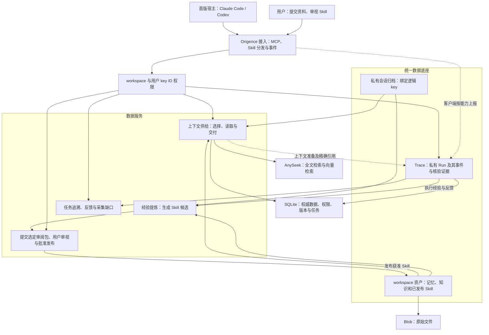

# Origence · 智能体统一数据底座架构规划

首版合同基线为 v0.8（2026-11-16）。本文描述目标架构与首版验收。

产品演进见[路线图](../ROADMAP.md)。当前实现架构、接口和进度分别见[平台设计](current-implementation.md)、
[API](../API.md) 和 [STATUS](../STATUS.md)。

## 1. 定位与首版范围

**Origence 是面向智能体的统一数据底座，涵盖记忆、知识、Skill 和 Trace。**
上下文组装按任务选择有权访问的数据，供智能体使用。Trace 以私有 Run 记录运行证据，供用户查证和提炼经验。

首版面向企业研发与业务团队，在内网以 **Claude Code 与 Codex** 的本地 CLI 试点。
用户可以从记忆和执行经历中选取依据，形成可审阅的 Skill 候选。发布需要有发布权的用户批准。
会话归档和 Run 按逻辑 key 私有隔离，同一 workspace 内一个逻辑 key 绑定一个会话。
已发布的记忆、知识和 Skill 归 workspace，在其中按权限复用，跨 workspace 隔离。
会话能力限于平台记录的归档与授权查询，不提供客户端工作现场恢复。

## 2. 总体架构

这是目标图。实线表示业务调用或数据依赖，虚线表示观测证据流；事件接收和查询均校验权限。
宿主负责模型调用、任务编排和工具执行。
全文与向量只有 AnySeek 一条目标检索路径，业务权威数据保留在 SQLite，原始文件保留在 Blob。

## 3. 核心数据与上下文

| 类型 | 管理内容 |
| --- | --- |
| 记忆 | 有主体、项目与适用条件的事实、偏好、已确认决策和经验 |
| 知识 | 企业文档、规范、接口定义、产品规则与授权业务资料 |
| Skill | 从记忆和 Agent 经历提炼的指令、步骤、流程、模板与参考资料 |
| Trace | 以 Run 组织的上下文准备记录、Skill 加载与工具使用报告、任务结果、反馈、外部核验与采集缺口 |

任务状态可以随显式提交的会话轮次、任务摘要或事件报告记录。Run 的工件上报保存外部工件的标识与摘要。上传的原始资料及已发布的 Skill 包各自有专用读取入口。
已发布数据使用精确版本和来源引用，观测与上报记录保留报告方和时间。来源授权须覆盖共享范围。

### 归属与隔离

| 层次 | 内容与访问边界 |
| --- | --- |
| 私有记录 | 已提交的会话轮次与反馈、Run 及上下文快照、未发布候选，按逻辑 key 隔离 |
| workspace 资产 | 正式沉淀的长期记忆、事实、知识与已发布 Skill；供同 workspace 的获授权用户/Agent 复用 |

同一 workspace 内，稳定的逻辑 `key_id` 映射到唯一 `session_id`；认证凭据与该逻辑身份分别管理，密钥明文不作为存储身份。
新建独立 key 产生独立会话；经过明确授权的密钥轮换可接续原逻辑 key 与会话，不能按用户名自动合并。
撤销凭据或 key 阻断对应访问；会话历史、已沉淀资产和来源撤回分别按各自生命周期处理，不随凭据撤销自动删除。
同一逻辑 key 在 Claude Code/Codex 中访问同一 Origence 归档会话记录；需要独立记录的 Agent 使用不同 key。
同一会话可包含多个任务/Run。会话归属由服务端认证派生，传入其他 session ID 不能切换所有权。
所有私有入口和上下文组装都校验逻辑 key 归属及当前权限。获准审阅者通过选定审阅包查看明确披露的内容。
实现合同：`GET /v1/session` 返回认证逻辑 key 的 `{session_id,key_id}`，无调用方可选归属。
`POST /admin/keys/{id}/rotate` 仅允许当前 admin 在凭据所属 workspace 内轮换；返回新凭据，旧凭据立即失效。
显式 SessionTurn 路由继续要求 writer，并额外匹配当前 key 的 session；读取权限与归属检查不能互相替代。
平台保存已提交的记录并提供查询，不同步或恢复客户端原生聊天、上下文窗口、工具/进程/环境状态，也不重放操作。

从私有记录沉淀时显式生成 workspace 资产并确定共享正文，保留受控来源关联；原会话与轨迹继续私有。
记忆/事实/知识遵守相应写入与发布权限，Skill 还必须经过用户批准。未沉淀的候选不作为共享长期资产。
私有内容对外共享须校验读取、披露与发布权限；审阅者只获准查看选定审阅包，workspace 发布角色不自动获得原始会话。
审阅包区分待发布工件（正文、manifest、参考资料）和必要脱敏依据；批准绑定精确修订、全部工件摘要、依据摘要及目标 workspace/版本/范围。
发布只共享清单中的获准工件，审阅依据不默认随包公开。
修改任一绑定内容须重新审阅，发布前重新核验权限与来源；发布只共享获准内容，原始会话及其引用仍受私有边界约束。

`EvidenceBundle` 按任务、权限和预算组装记忆、知识和 Learning，调用方可按权限加入自己的归档轮次。准备记录保存精确引用、缺失和裁剪信息。见[上下文组装契约](../contracts/evidence-bundle.md)。

宿主通过独立的 Skill 下载或导出入口取得有效的已发布包，再按自身机制加载。Run 中的加载事件来自客户端上报。候选进入专门的用户审阅入口。

## 4. Skill 如何从经验沉淀

Agent 或平台从授权记忆和已记录的执行经历提炼目标、前提、参数、步骤、检查点与验证方法；
保留失败案例、适用限制和证据缺口。一次任务自报成功不能直接证明方法可靠。
首版由用户选择依据并发起候选。自动提出候选的探索见[产品路线图](../ROADMAP.md#分阶段推进)。

用户应能在可读的候选详情中审视：

| 内容 | 用户看到什么 |
| --- | --- |
| 方法 | 要解决什么问题、如何做、输入/输出、检查与验证步骤 |
| 依据 | 支持的记忆版本、运行记录、工具/结果和反馈，哪些部分尚未证实 |
| 边界 | 适用条件、失败/反例、尚未验证的情况 |
| 变化 | 相对已发布版本的内容差异、修改原因与审阅记录 |

用户可编辑、驳回候选，或作为新 Skill/新版本发布；已发布版本也可查看其依据与历史。
候选继承输入的私有范围，由获准提交者选定正文与脱敏依据组成审阅包；审阅权限限于该包。
**Skill 必须经有发布权的用户批准后发布。** 批准绑定上述审阅包与发布目标，发布者按批准的精确内容生成工件。
发布为不可变的 `SKILL.md`、manifest 和参考资料包，记录版本、摘要、支持来源与审阅决定，
再由两种客户端的适配器分发和加载。新经验形成后续候选，保留已发布版本的历史。
首版包只包含文本指令、受控参考资料与白名单元数据；发布器校验包内容和客户端允许字段，
拒绝工具预授权、hooks、动态命令和可执行脚本扩展。凭据不进入 Skill 包。
批准共享 Skill 不授予实际操作权限；工具调用继续服从执行端与业务工具已有权限/审批规则。
受管安装与加载清单按 workspace 隔离；撤回阻断后续分发/受管加载，离线或已导出副本的即时回收不作保证。

## 5. Trace：运行证据

Trace 以 **Run** 关联任务摘要、上下文准备、Skill 版本、工具事件、结果、反馈与采集覆盖。
Run 和事件沿用所属会话的逻辑 key 隔离。用户可将获准披露的结果或经验另行发布为 workspace 资产。

| 证据来源 | 能记录什么 |
| --- | --- |
| Origence 服务端 | 指定 Run 的上下文准备结果、精确引用、准备诊断与采集边界 |
| 客户端适配器 | 按实际能力上报 Skill 加载、工具调用、结果、工件引用与采集缺口 |
| 用户或测试 | 各自报告的任务反馈与结果 |
| Run 所有者 | 针对精确 Run 前缀转录的外部核验，标明声明来源 |

每条事件保留运行身份、报告方、时间和稳定事件 ID，重复上报幂等处理。
服务端准备回执、客户端报告和外部核验各自保留证据来源。Skill 的批准与发布决定保存在 Skill 审阅记录中。

**MCP 只能观测经过自身的请求。** 客户端未上报的活动标为未知或采集缺口。
首版提供可读的任务追溯详情，将上下文、Skill、工具与结果串起来。
默认保存引用、必要状态和脱敏摘要；凭据不进入上下文或观测记录。

## 6. Origence 与 AnySeek 分工

| 工作 | Origence | AnySeek |
| --- | --- | --- |
| 数据准备 | 接入资料、保留原文、解析/切块、生成查询与文档向量 | 保存文本、向量与检索 metadata，维护索引 |
| 检索 | 派生授权范围、发起全文/向量查询、复核来源与版本、组装引用 | 全文匹配、向量相似检索与候选排序 |
| 资产、上下文与 Trace | 资产生命周期、经验提炼、Skill 审阅发布、上下文组装与运行证据 | 保存发布后的检索正文并提供候选 |
| 持久化 | SQLite 保存权限、版本元数据、Skill 包、Trace 和持久任务，Blob 保存原始文件 | 按稳定记录身份持久化发布正文、摘要与索引 |

Origence 选择并固定 embedding 模型/profile 和维度，AnySeek 执行向量检索。
检索 metadata 携带完整 workspace、资产/来源版本和 generation；候选过滤与最终权威复核保持一致。
私有材料不默认进入 workspace 共享召回；检索/读取私有材料时额外复核 owner key 与 session，不能仅按 workspace 放行。
本地宿主通过 AnySeek Rust SDK 打开磁盘 Catalog。独立部署时，Origence 持有 AnySeek URL 和服务凭据。
两种模式都从已鉴权 Scope 派生命名空间与集合。独立模式通过 `X-AnySeek-Tenant` 传 tenant UUID。每个 workspace 使用独立
`ws_<无连字符 workspace UUID>` 集合，首次使用按固定 schema 初始化。
已有发布的集合在启动时检查，丢失或配置不兼容明确报错；该存储隔离不替代用户权限、
私有会话与来源/版本复核。
撤权或来源撤回先阻断后续读取/分发，再清理索引；快照和 Skill 不能绕过该规则。
依赖故障明确返回不可用，不伪装为空召回。

实现复用现有发布账本、单持久 Worker、原计划恢复和来源定位规则；外部模型/索引 IO 留在事务外。
Origence 不维护第二套全文/向量引擎，构建依赖和部署配置遵守统一 AnySeek 的边界。

## 7. 实施顺序与验收

| 顺序 | 要完成什么 | 验收结果 |
| --- | --- | --- |
| 1. 统一检索与双客户端接入 | 全文/向量接 AnySeek，落实逻辑 key→归档会话绑定与 workspace 资产隔离 | 同 key 跨客户端可查询同一归档、独立 key 隔离、获授权轮换可接续；workspace 检索返回有效引用 |
| 2. Skill 经验沉淀 | 接入记忆/运行依据，生成候选，提供用户审视、修改和发布 | 研发/业务各一个 Skill 可追溯依据，经有发布权用户批准后发布，并能在两客户端复用 |
| 3. Trace 与任务核验 | 固定上下文清单，关联 Skill、可观察工具、结果和反馈 | 真实任务可读地串联已采集证据，并显式显示未采集部分 |

Run 和结果记录随接入过程逐步补齐，供 Skill 提炼使用；第 3 步完成统一追溯体验。

每步同时核验：权限隔离、来源更新/撤回、精确版本引用、重复请求与重开恢复。
跨 key 直接读取、Bundle/检索、Run 查询、工件和来源跳转均不能泄露私有内容；跨 workspace 不可共享资产。
Skill 还需核验候选修改后批准失效、支持来源失效后的读取/分发行为。
同时验证未授权提交/审阅被拒、包摘要或发布目标变化使批准失效、执行扩展被拒，以及跨 workspace 的本地加载隔离。
会话验收只覆盖归档/查询、授权轮换、撤销阻断和数据保留；客户端工作现场恢复不列为能力或验收项。
检索替换通过公开库、HTTP/MCP 和实际 AnySeek 验证；客户端收益使用冻结任务比较，文档或协议 fixture 不代表真实任务通过。

当前代码、验证结果与未完成范围分别见 [STATUS](../STATUS.md) 和 [VALIDATION](../VALIDATION.md)。

## 8. 已确认决定与试点准备

以下为首版试点与验收边界。

- **部署与接入**：内网部署，首版以 Claude Code/Codex 本地 CLI 为基线。
- **Skill 发布**：必须由有发布权用户批准；候选生成不等于发布。
- **试点方向**：研发覆盖数据库排障，业务覆盖报销复核，材料、版本与独立签认见 [P0 验收 #91](https://github.com/TheLudlows/Origence/issues/91)。
- **数据归属**：同用户 API key 共用同一私有会话；长期记忆/事实/Skill/知识归 workspace，沉淀不公开原始会话。
- **会话边界**：独立新 key 默认独立，获授权的密钥轮换可接续；仅归档/查询平台记录，不提供工作现场恢复。
- **共享与执行**：以选定审阅包批准共享；首版 Skill 仅文本/参考资料，发布批准和实际操作授权分别处理。

按第 7 节拆分实现合同并推进；候选生成策略等操作细节随实现落实，既有领域合同仍在各自文档维护。

## 9. 设计参考

以下资料于 2026-11-16 查阅，用于比较机制，不作为 Origence 的实现或效果证明。

| 参考 | 采用的边界 |
| --- | --- |
| [LangGraph Persistence](https://docs.langchain.com/oss/python/langgraph/persistence)、[LangMem](https://langchain-ai.github.io/langmem/concepts/conceptual_guide/) | 私有任务状态与跨任务资产分开，事实、经历和方法分别表达 |
| [Letta Skills](https://docs.letta.com/configuration/skills) | 从执行经历形成可复用方法，按 workspace 发布并保留人工批准 |
| [Agent Skills](https://agentskills.io/specification)、[Claude Code](https://code.claude.com/docs/en/skills)、[Codex](https://learn.chatgpt.com/docs/build-skills) | 通用文本包与客户端加载分开验收，发布不授予工具执行权限 |
| [Langfuse Sessions](https://langfuse.com/docs/observability/features/sessions)、[LangSmith Threads](https://docs.langchain.com/langsmith/threads) | 用 session/Run 关联证据，区分真实采集与缺口，不提供工作现场恢复 |
