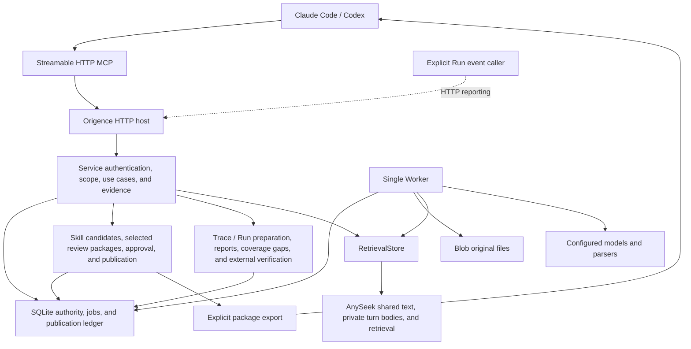

# Origence · Current platform design

**English** · [简体中文](current-implementation.md)

Product and storage boundaries reviewed against main `d4867aa` on 2026-11-27. See [API](../API.en.md) for contracts, [OPERATIONS](../OPERATIONS.en.md) for operation and recovery, [STATUS](../STATUS.en.md) for progress, and [VALIDATION](../VALIDATION.en.md) for acceptance. A1–A6 numbers and explicit anchors are retained for source-code references. Historical designs are in Git. The [architecture plan](agent-data-foundation.en.md) describes first-release goals and acceptance contracts.

## 1. Product scope

Origence is the unified data foundation for AI agents, covering memory, knowledge, Skills, and Trace. It currently provides memory and knowledge writes and retrieval, Skill candidates and approved publication, private Run recording and reading, context assembly, and explicit session learning.

- Origence stores, delivers, and traces authorized data. Claude Code and Codex handle inference, orchestration, Skill loading, and tool execution. Origence can call configured models for its data processing and record explicitly submitted turns. Agent hosts manage their native chats, tool processes, and working state. Tool calls still require execution-side authorization after Skill publication.
- Private Q&A, feedback, Runs, and unpublished candidates are isolated by stable logical key within each workspace. Authorized rotation preserves access to the same archive. Published memory, knowledge, Learning, and Skills are shared under workspace authorization. Moving private material into shared use requires explicit submission, source validation, and the applicable publication workflow.
- Claude Code and Codex are the initial pilot hosts. Server preparation, client reports, and owner-transcribed external assessments are recorded separately. Uncollected activity stays unknown. The pilot evaluates real task outcomes and independent assessment. [STATUS](../STATUS.en.md) · [P0 pilot #91](https://github.com/TheLudlows/Origence/issues/91)

## 2. Current architecture

HTTP and the single Worker share one `StorageEngine`. SQLite holds the data directory's exclusive OS lock. MCP clients connect directly to the host's `/mcp` endpoint, the Node.js console uses HTTP, and offline CLI access opens the directory exclusively. Origence can open AnySeek in-process through the Rust SDK or connect to a standalone server over HTTP. Origence holds the standalone service credential. [Operations and deployment](../OPERATIONS.en.md#anyseek-full-text-and-vector-retrieval)

## A1. Content, sources, and publication

Source events and original Blobs, content items and versions, chunks, summaries, graph objects, SessionTurn, and Learning have separate lifecycles. Preserve original input, historical versions, immutable locators, and parser markers. Indexes are not authoritative for sources. Business versions, source versions, index generations, and technical AnySeek Record/group versions are distinct. Explicit input and controlled extraction reuse a publication path. Commands are idempotent, and retrying a write with a new ID cannot resolve an unknown result.

## A2. Storage, isolation, and consistency

### A2.1 Storage ownership

| Component | Current responsibilities | Implementation |
| --- | --- | --- |
| SQLite | Permissions, sources, versions and publication ledger, durable jobs, versioned long-term facts, private archive directories and hashes, Run and Skill records and packages | `context.db` |
| AnySeek shared collections | Published chunk text, summaries, and full-text, vector, and one-hop graph indexes | Routed by tenant and workspace |
| AnySeek private collections | Complete original Q&A with keyword and vector projections | Routed by tenant, workspace, and logical key |
| BlobStore | Original upload bytes | Local directories addressed by scope/hash |

Origence determines permissions, provenance, and visibility. AnySeek persists text and serves candidates. Recovery of archived or published text requires the matching AnySeek data.

### A2.2 Interface boundaries

Without default features, the core library does not depend on SQLite. Callers can use pure data contracts, parsing, models, Blob storage, and the remote AnySeek client independently. `sqlite` supplies the authoritative transaction adapter. `local-storage` builds a host using only remote AnySeek, while `embedded-anyseek` enables the local SDK in the default native build. The host still persists and validates permissions, text and versions, sources, idempotency, and recovery state. Empty read sets avoid unrelated tables. Initialization and explicit checks validate full structure.

`StorageEngine` composes `RelationalStore`, `JobQueue`, `VectorStore`, and `BlobStore`. `Service` currently binds to `LocalEngine` and SQLite transactions and is not a generic database runtime. `VectorStore` also carries full-text interfaces for now and `RetrievalStore` implements delegation. Storage SQL stays in adapters. All business transactions carry scope. Model, file, and remote index I/O execute outside transactions. Business state, idempotency, audit, and enqueue commit together. The JobQueue consumer does not register jobs on a separate connection. The old storage capability flags do not exist. `KeyCapabilities` refers to authorization capabilities.

### A2.3 Initialization lifecycle

On startup, open and validate SQLite exclusively, check the backend binding, open the local AnySeek Catalog or verify the remote service credential, persist the routing binding, assemble and check projections and Blob storage, check committed workspace collections, recover jobs and remove orphans, then open the service. Normal startup requires a compatible schema. Automatic upgrades, data conversion, and rebuilding of missing collections are outside startup. The immediately preceding private archive schema has a separate [offline migration and paired recovery procedure](../OPERATIONS.en.md#private-archive-and-paired-recovery).

An AnySeek backend can be selected initially only for an unbound directory with no published full text. Successful initialization stores format, endpoint, tenant/workspace routing, and model profile and dimensions in `full-text-backend.json` format `origence-content-backend-v2` without an API key. On first use, persist the collection analysis digest before publication. It may be absent only without published full text. The read is bounded under the authority's exclusive lock. Sync the staging file and publish it atomically. On Unix also sync the parent directory. Later target or model mismatches and corrupt bindings fail before remote I/O. Rotating a service credential for the same endpoint, route, and model leaves the binding intact. An authenticated Scope determines the tenant UUID namespace and `ws_<workspace UUID 无连字符>` (workspace UUID with no hyphens) collection. First use creates the fixed schema. Reopen strictly checks published collections and does not rebuild missing ones. Ordinary process restart and arbitrary power loss have separate acceptance. Staging remnants are not valid bindings.

### A2.4 Scope and retrieval visibility

Scope is derived from authentication and cannot be chosen by models. Full identity, current version, sources, and ownership constrain candidates first. Native search filters before top-k. Recheck before return in a fresh authorization transaction and revalidate permissions at commit. AnySeek namespaces and generic metadata filters do not authorize employees. Origence keeps user and session keys, permissions, and business scope checks. Withdrawn sources and tombstones leave later reads after authoritative commit without waiting for physical projection cleanup. Historical reads still validate sources.

AnySeek checks batches of all authorized candidates for missing or duplicate IDs, source, and generation before searching terms or vectors. Metadata and storage errors fail explicitly. Read text and locator from AnySeek payloads, verify content hashes and provenance in SQL, and recheck authorization and visibility after remote I/O.

### A2.5 Single Worker and recovery

Job leases carry creator, scope, generation, and run_token. After model calls, parsing, or external indexing, the final transaction rechecks creator permission, cancellation, sources, current content item version, and run identity. Explicit cancellation blocks late publication without guaranteeing immediate stop of blocking parsing or in-flight remote writes. The existing queue owns bounded durable retry. Database and internal failures and explicitly transient dependencies can be retried. Model and configuration failures keep their classifications. `spawn_blocking` is not a second business Worker.

### A2.6 Cross-storage publication and cleanup

1. The authoritative transaction saves a publication plan and pending ledger. The AnySeek plan retains the original operation epoch.
2. Outside the transaction, write text, summaries, full text, vectors, and graph projections to the same AnySeek collection with complete deterministic identities.
3. The authoritative transaction rechecks run, sources, permissions, and version, then commits version metadata and content hash, owner, ready index, and job completion.
4. After failure or withdrawal, follow the authoritative cleanup plan to remove orphans. Valid evidence for a relationship retains its own owner and projection.

AnySeek writes the immutable publication's chunks as one atomic Record group. One chunk can carry graph metadata. Each new business version uses a separate group. There is no shared Origence/AnySeek transaction. On a lost response, check the complete current group first. Recover with the original plan and epoch. Cleanup uses a CAS on the current group version to preserve other members. A still-valid job after startup cleanup can rebuild with the original plan. If no complete commit can be proved outside the original operation window, preserve failed state without guessing using a new identity.

SQLite registers a private turn as pending. AnySeek atomically commits its body and search projection before Origence marks it archived. Withdrawal blocks delivery before AnySeek cleanup. [Archive API](../API.en.md#session-archiving-and-idempotent-feedback)

### A2.7 Configuration and failure boundaries

The host selects embedded local or remote AnySeek. In remote mode, library callers use `Service::open_with_anyseek(dir, models, config)`. Unknown backends, missing remote settings, and storage errors do not silently fall back. Only model failures allowed by the request can fall back to keyword under the existing contract.

Origence sends SHA-256 encoded terms to AnySeek, preserving AND and term frequency. Evaluate BM25 ranking on the actual backend and task set. See [API](../API.en.md#unified-anyseek-retrieval) and [OPERATIONS](../OPERATIONS.en.md#anyseek-full-text-and-vector-retrieval) for publication, candidate, response, timeout, analysis configuration, and parsing limits. Full-corpus relevance, capacity, and latency are unaccepted.

### A2.8 Acceptance

Record engineering regressions, actual engine and Streamable HTTP MCP, real Claude Code clients, and real task outcomes separately. Prior passing revisions do not establish the current head. Average quality cannot offset isolation and source validity failures. See [VALIDATION](../VALIDATION.en.md) for entry points and precise results and STATUS for gaps.

## A3. Identity, sessions, and conditional experience

Explicit memory identity comprises scope + subject + predicate + canonical context. Similarity does not authorize replacement. The [identity specification](../contracts/memory.en.md) defines single/multi-value state, conflict evidence, and whole-snapshot withdrawal. SessionTurn explicitly archives evidence actually used. Archives and Runs bind to the workspace's stable logical key. Independent keys are isolated and authorized rotation preserves continuity. Feedback is idempotent without automatic ranking changes. Improve explicitly proposes, verifies, and publishes Learning via ordinary knowledge publication. It preserves conditions and complete support closure, without learning from all interactions automatically or a separate Guidance lifecycle.

Long-term facts retain versions, sources, and effective times in SQLite. Ordinary Context can evaluate them at a business time. Experience retrieval uses currently visible published Learning. Dated queries use ordinary Context or the long-term memory APIs. Run context preparation rejects `as_of_ms`. [Long-term memory](../contracts/memory-consolidation.md)

EvidenceBundle gives memory, knowledge, and Learning independent retrieval and UTF-8 byte budgets. Session defaults off and only a writer on the current key can read it. Only explicit single-value identity conflicts are recognized. General prose contradictions are not inferred. Session references must not be fabricated as chunk/entity/relation archive references. See the [memory](../contracts/memory.en.md), [learning](../contracts/learning.md), and [context](../contracts/evidence-bundle.md) contracts.

## A4. Skills and Runs

The caller submits Skill candidates. The selected-experience CLI can populate a candidate from a supplied method and one exact source, such as a Run prefix or published Learning version. Candidates, revisions, and notes are private. Owners select a review package for named reviewers. Approval binds exact package and destination. Publications are immutable, sources are revalidated on distribution, and two client-specific directory formats can be exported. Export does not prove native loading or recall of offline copies. See the [Skill contract](../contracts/skills.md) and [selected-experience CLI](../SKILL-CANDIDATE-CLI.md).

Trace is stored by Run under the logical key. The server records exact prepared context. Clients report tools, Skills, results, and artifact references. Artifact reports keep external IDs and digests. Run owners can transcribe external assessments for an exact prefix and retain independent provenance markers. Unreported activity stays unknown. See the [Run contract](../contracts/runs.md) and [external verification contract](../contracts/run-verification.md).

## A5. Data model and sources of constraints

DDL defines the physical schema. See [storage invariants](../contracts/storage.en.md) for identity reservations, independent lifecycles, and recovery. New queries follow [AGENTS](../../AGENTS.md) for JOIN-free SQL, transactions, and provenance. Retaining original text, same-version backup/restore, durability, and retry remain required.

## A6. Protocol boundaries

See [API](../API.en.md) for HTTP and library DTOs. MCP exposes retrieval for memory, knowledge, and Learning, explicit private archiving, and Run tools. Run tools forward over HTTP to a running host. Skill download and native client loading are recorded separately. The server cannot recall explicit exported copies. [Dual-client integration](../CLIENTS.en.md)
