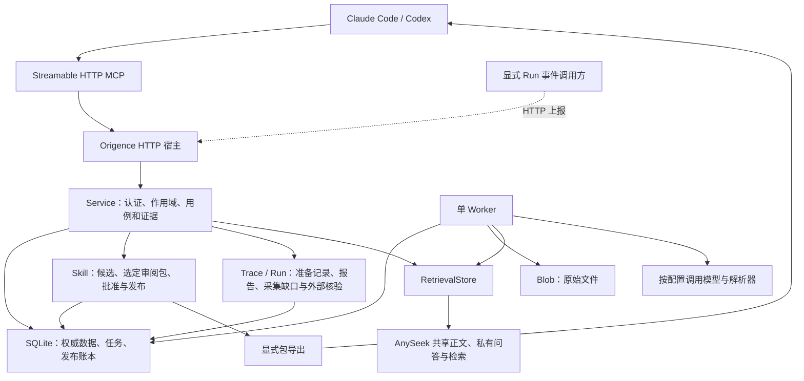

# Origence · 当前平台设计

**简体中文** · [English](current-implementation.en.md)

产品与存储边界复核基线为 main `d4867aa`（2026-11-27）。接口见 [API](../API.md)，运行与恢复见
[OPERATIONS](../OPERATIONS.md)，进度见 [STATUS](../STATUS.md)，验收见 [VALIDATION](../VALIDATION.md)。
A1–A6 编号与显式锚点保留，供代码中的设计引用使用；旧方案可从 Git 历史查阅。
首版目标与验收合同见[架构规划](agent-data-foundation.md)。

## 1. 产品边界

Origence 是面向智能体的统一数据底座，涵盖记忆、知识、Skill 和 Trace。当前提供记忆与知识的写入和检索、Skill 候选与审批发布、Run 记录与授权查询，以及上下文组装和显式会话学习。

- Origence 负责保存、授权交付和追溯数据。Claude Code 与 Codex 负责推理、编排、加载 Skill 及执行工具。Origence 可为数据处理调用配置好的模型，并记录显式提交的会话轮次。客户端管理原生聊天、工具进程和工作现场。Skill 发布后，工具调用仍由执行端鉴权。
- 新部署可用同一把工作空间 Key 登录控制台和连接 Agent。私有问答、反馈和未发布候选由工作空间的稳定逻辑 Key 隔离，轮换后保留原归档归属。部署管理员可查看所有空间的原始会话、Run 和已发布的记忆与知识。成员授权的工作区仍允许本区管理员读取 Run 链路，Run 写入和重放继续校验所有权。
- 记忆、知识、Learning 和 Skill 发布在原工作空间。原始私有内容的发布需要显式提交和来源复核。工作空间可提交已发布知识的固定版本供部署管理员审核。审核通过的独立副本可在全局目录读取，并与本空间内容一起召回。
- 首版试点使用 Claude Code 和 Codex。服务端准备记录、客户端上报和所有者转录的外部核验分别保存。未采集的活动保持未知。真实任务效果和独立签认按试点验收。[STATUS](../STATUS.md) · [P0 试点 #91](https://github.com/TheLudlows/Origence/issues/91)

## 2. 当前架构

HTTP 与单 Worker 共享一个 `StorageEngine`。SQLite 持有数据目录的独占 OS 锁。客户端 MCP 直连宿主的 `/mcp`，Node.js 管理界面通过 HTTP 访问服务，离线 CLI 要求独占打开。Origence 可用 Rust SDK 在进程内打开 AnySeek，也可通过 HTTP 连接独立服务。独立服务的凭据由 Origence 持有。[运行与部署](../OPERATIONS.md#anyseek-全文与向量)

## A1. 内容、来源与发布

Source event/原始 Blob、内容条目及其版本、chunk、summary、图对象、SessionTurn 和 Learning
分别管理生命周期。原始输入、历史版本、不可变 locator 与 parser 标记保留；索引不是来源权威。
业务版本、来源版本、索引 generation 与 AnySeek Record/group 技术版本分开处理。
显式输入与受控提取复用同一发布路径；重复命令幂等，未知结果不能靠新 ID 猜测补写。

## A2. 存储、隔离与一致性

### A2.1 存储归属

| 组件 | 当前职责 | 实现 |
| --- | --- | --- |
| SQLite | 权限、来源、版本与发布账本、持久任务、版本化长期事实、会话序号分配与请求幂等、Run/反馈实际引用的证据、Skill 记录和包 | `context.db` |
| AnySeek 共享集合 | 已发布的分块正文、摘要及全文、向量和一跳图索引 | 按租户与 workspace 路由 |
| AnySeek 私有集合 | 完整原始问答、轮次顺序、来源引用和哈希，以及关键词和向量投影 | 按租户、workspace 和逻辑 key 路由 |
| BlobStore | 上传原件的字节 | 以 scope/hash 定位的本地目录 |

Origence 负责判定权限、来源和可见状态。AnySeek 同时持久化正文并提供候选，归档与发布正文的恢复需要配套 AnySeek 数据。

### A2.2 接口边界

关闭默认特性后，核心库不依赖 SQLite。纯数据契约、解析、模型、Blob 与 AnySeek 远端客户端可独立使用。`sqlite` 提供权威事务适配器，`local-storage` 组合仅使用远端 AnySeek 的宿主，`embedded-anyseek` 为默认原生构建启用本地 SDK。服务端仍必须持久化并核验权限、正文/版本、来源、幂等和恢复状态。空读集合不触碰不参与本次判断的表，初始化与显式检查负责验证完整结构。

`StorageEngine` 是组装结构，持有 `RelationalStore`、`JobQueue`、`VectorStore`、
和 `BlobStore`。当前 `Service` 仍具体绑定 `LocalEngine`/SQLite 事务，
并非任意数据库的通用运行时。`VectorStore` 暂同时承载全文接口，`RetrievalStore` 完成委派。
存储 SQL 留在适配器；所有业务事务携带 scope。模型、文件与远端索引 IO 在事务外执行。
业务、幂等、审计和入队同事务提交，JobQueue 消费者不在另一连接补登记任务。
不存在旧设计中的存储 capability flags；`KeyCapabilities` 是授权能力，含义不同。

### A2.3 初始化生命周期

启动顺序为独占打开并核验 SQLite、检查后端绑定、在本地打开 AnySeek Catalog 或验证远端服务凭据、持久化路由绑定、装配并检查投影和 Blob、检查已提交 workspace 集合、恢复作业并清理孤儿，随后开放服务。正常启动要求兼容结构，不自动升级、转换数据或重建丢失的集合。私有归档的停机验证见[配套备份恢复](../OPERATIONS.md#私有问答归档与配套恢复)。

AnySeek 首次选择仅允许无已发布全文且未绑定的目录。成功初始化后，在
`full-text-backend.json` 的 `origence-content-backend-v2` 格式保存格式、endpoint、tenant/workspace 路由规则和模型 profile/维度，排除 API key。
首次使用集合时先持久化分析摘要，再允许发布；无已发布全文时才允许摘要尚未初始化。
在 authority 独占锁下有界读取，暂存文件同步后原子发布；Unix 额外同步父目录。
后续目标或模型配置不匹配、绑定损坏均在远端 IO 前拒绝。
同 endpoint/路由/模型下轮换服务凭据不修改绑定。数据请求从已鉴权 Scope 派生 tenant UUID 命名空间
与 `ws_<workspace UUID 无连字符>` 集合；首次使用自动创建固定 schema，重开严格检查已有发布的集合，丢失不重建。
普通进程重开与任意断电保证分别验收，暂存残片不作为有效绑定。

### A2.4 作用域与检索可见性

scope 来自认证，不接受模型指定。完整身份/当前版本/来源/owner 先限定候选，
原生检索在 top-k 前过滤；返回前在新的授权事务内复核，提交再次检查权限。
Origence 在 AnySeek 的租户命名空间和元数据过滤之外，继续复核 Key、会话、权限与工作空间范围。
已撤回来源和墓碑在权威提交后退出后续读取，不等待投影物理清理；历史读取仍检查来源。

AnySeek 对全部授权候选分批核对缺失、重复、来源和 generation，再执行词项或向量检索。
metadata 或存储错误明确失败；正文与 locator 从 AnySeek payload 读取，核验 SQL 中的内容哈希及 provenance，远端 IO 后再复核授权和可见性。

### A2.5 单 Worker 与恢复

领取任务携带 creator、scope、generation、run_token。模型/解析/外部索引后，最终事务
复核 creator 权限、取消、来源、当前内容条目版本与运行身份。显式取消阻断迟到发布，
不保证立即停止 blocking 解析或已发出的远端写入。
原队列管理有上限的持久重试；数据库/内部故障及显式临时依赖错误可重试，
模型与配置错误保持原分类。源码中的 `spawn_blocking` 不构成第二个业务 Worker。

### A2.6 跨存储发布与清理

1. 权威事务保存发布计划、pending 账本；AnySeek 计划保存原 operation epoch。
2. 在事务外向同一 AnySeek collection 写入正文、摘要、全文、向量和图投影，使用确定性完整身份。
3. 权威事务再次核对运行/来源/权限/版本，提交版本元数据/内容哈希、owner、ready 索引及作业完成。
4. 失败或撤回后按权威清理规划删除孤儿；图关系的有效来源保留自己的 owner 和独立投影。

AnySeek 用一组 Record 原子写入一次不可变发布的所有 chunk，其中一个可附带图元数据。各业务版本使用独立组。
这不是 Origence 与 AnySeek 的共同事务。响应丢失先核对完整当前组；原计划恢复复用 epoch。
清理以当前 group 版本 CAS 保留其他成员，启动清理后仍有效的作业可在原计划下重建。
超出原操作窗口且无法确认完整提交时保留失败状态，不换身份猜测写入。

新私有问答用一个 AnySeek 原子组提交正文、目录及检索投影。稳定轮次 ID 与请求哈希用于确认提交和重试。删除由 AnySeek 按组确认。SQLite 沿用普通来源撤回规则保护已有依赖证明。[归档 API](../API.md#会话归档与幂等反馈)

### A2.7 配置与失败边界

宿主须选择本地嵌入式或远端 AnySeek。远端模式的库调用方使用 `Service::open_with_anyseek(dir, models, config)`。未知后端、缺少远端配置和存储错误不静默降级。只有请求允许的模型失败可按原契约降为 keyword。

Origence 对分词结果逐词做 SHA-256 编码后交给 AnySeek，保留 AND 与词频。BM25 排序在实际后端和任务集上独立评估。
发布、候选、响应、超时、分析配置和解析限制见 [API](../API.md#anyseek-统一检索) 与
[OPERATIONS](../OPERATIONS.md#anyseek-全文与向量)。全库相关性、容量和延迟未验收。

### A2.8 验收

工程回归、真实引擎/Streamable HTTP MCP、真实 Claude Code 客户端、真实任务效果分别记录。
旧版本通过不外推到当前 head。治理隔离和来源有效性不能由平均质量分抵消。
验收入口与精确结果统一在 [VALIDATION](../VALIDATION.md)，当前缺口统一在 STATUS。

## A3. 身份、会话与条件经验

显式记忆身份由 scope + subject + predicate + 规范 context 决定，语义相似不授予覆盖权。
单值/多值、冲突证据和整快照来源撤回见 [身份规格](../contracts/memory.md)。
SessionTurn 显式归档实际使用的证据。单 Key 工作空间的原始会话保留，归档后由持久 Worker 在本空间提取记忆。删除提取记忆后，同一来源重放仍保留删除状态。Feedback 幂等且保持原有授权。
Improve 显式提案、核验并经普通知识发布 Learning，保留适用条件和完整支持闭包。
它不等于自动学习所有交互，也没有独立 Guidance 生命周期。
工作区 writer 也可用人工确认或固定知识版本直接发布经验，走同一发布通道。

正式长期事实在 SQLite 保留版本、来源和生效时间，普通 Context 可按业务时点求值。经验召回使用当前有效的已发布 Learning。带 `as_of_ms` 的查询走普通 Context 或长期记忆接口，Run 上下文准备会拒绝该参数。[长期记忆](../contracts/memory-consolidation.md)

EvidenceBundle 对 memory、knowledge、Learning 分配独立召回与 UTF-8 字节预算；session
默认关闭且仅当前 key 的 writer 可读。仅识别明确单值身份冲突，不推断一般文本矛盾。
会话引用不能伪造为现有 chunk/entity/relation 归档引用。具体规则见[记忆](../contracts/memory.md)、[学习](../contracts/learning.zh-CN.md)和[上下文](../contracts/evidence-bundle.zh-CN.md)契约。

## A4. Skill 与 Run

Skill 候选由调用方提交。选定经历 CLI 可根据调用方提供的方法与一个精确依据预填候选，
例如 Run 前缀或已发布 Learning 版本。候选/修订与备注私有，所有者选定
审阅包交付指定审阅者，批准绑定精确包与目标。发布版本不可变、分发时重新核验来源，
显式导出两种客户端目录格式；原生加载与离线副本回收不属于导出证明。
细节见 [Skill 契约](../contracts/skills.zh-CN.md)和[选定经历 CLI](../SKILL-CANDIDATE-CLI.zh-CN.md)。

Trace 按 Run 存储，归属逻辑 key。服务端记录准备过的精确上下文，客户端上报工具、Skill、结果和工件引用。工件上报保存外部 ID 与摘要。Run 所有者可以为精确前缀转录外部评估，保留独立的来源标记。客户端未上报的活动保持未知。见 [Run 契约](../contracts/runs.zh-CN.md)和[外部核验契约](../contracts/run-verification.zh-CN.md)。

## A5. 数据模型与约束来源

物理 schema 以 DDL 为准，身份占位、独立生命周期与恢复要求见[存储不变量](../contracts/storage.md)。
所有新查询遵守 [AGENTS](../../AGENTS.md) 的无 JOIN、事务和来源约束。
原文保留、同版本备份恢复、持久化与重试仍是要求。

## A6. 协议边界

HTTP 与库 DTO 见 [API](../API.md)。MCP 提供记忆、知识和 Learning 的检索、显式私有会话归档与 Run 工具。Run 工具经 HTTP 转发给运行中的宿主。Skill 下载和客户端原生加载各自记录，
显式导出的副本不会由服务端追回。见[双客户端接入](../CLIENTS.md)。
