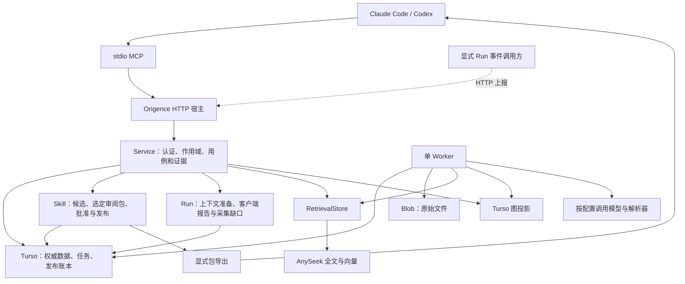

# Origence · 当前平台设计

更新：2026-11-17。代码基线：main `0a1a56c`。本文负责当前架构与不变量；接口见 [API](../API.md)，运行与恢复见
[OPERATIONS](../OPERATIONS.md)，进度见 [STATUS](../STATUS.md)，验收见 [VALIDATION](../VALIDATION.md)。
A1–A6 编号与显式锚点保留，供代码中的设计引用使用；旧方案可从 Git 历史查阅。
首版目标另见[架构规划](agent-data-foundation.md)。当前实现包括 AnySeek 统一检索、
私有归档、Skill 审批发布与 Run 追溯的基础路径；真实客户端和任务验收与代码实现分开记载。

## 1. 产品边界

Origence 为企业内部 Agent 提供受权限控制、可追溯的记忆与知识等上下文。支持 Claude Code 和 Codex 的 stdio 配置、显式私有归档工具及批准包导出；两者真实客户端均待验收。
当前提供显式知识/记忆写入、检索、上下文组装及受控会话学习，
企业身份、文档 ACL 与项目自动关联尚未实现，真实开发任务效果仍待验收。
首版范围以架构规划为准，当前进度统一在 STATUS 维护。

## 2. 当前架构

HTTP 与单 Worker 共享一个 `StorageEngine`；Turso authority 持有数据目录的独占 OS 锁。
CLI/MCP 默认转发到运行中的宿主；离线访问要求独占打开。AnySeek 是独立 HTTP 服务，
普通 Tenant key 只由宿主持有。它保存检索投影，不判定员工权限或业务来源是否有效。

## A1. 资产、来源与发布

Source event/原始 Blob、asset/version、chunk、summary、图对象、SessionTurn 和 Learning
分别管理生命周期。原始输入、历史版本、不可变 locator 与 parser 标记保留；索引不是来源权威。
业务版本、来源版本、索引 generation 与 AnySeek Record/group 技术版本分开处理。
显式输入与受控提取复用同一发布路径；重复命令幂等，未知结果不能靠新 ID 猜测补写。

## A2. 存储、隔离与一致性

### A2.1 存储归属

| 组件 | 当前职责 | 实现 |
| --- | --- | --- |
| RelationalStore / JobQueue | 权限、来源、正文、版本、身份、审计、任务、owner 与发布账本 | 原生 Turso `context.db` |
| RetrievalStore | 带作用域、来源、generation 与模型 profile 的全文/向量投影 | AnySeek HTTP |
| 私有 Run / Skill | 私有事件、候选与批准包，分发复核来源 | 原生 Turso `context.db` |
| GraphStore | 图实体、关系及遍历投影 | 原生 Turso `graph.db`；owner 权威仍在 authority |
| BlobStore | 原始文件字节 | scope/hash 限定的本地目录 |

### A2.2 接口边界

`StorageEngine` 是组装结构，持有 `RelationalStore`、`JobQueue`、`VectorStore`、
`GraphStore` 和 `BlobStore`。当前 `Service` 仍具体绑定 `LocalEngine`/Turso 事务，
并非任意数据库的通用运行时。`VectorStore` 暂同时承载全文接口，`RetrievalStore` 完成委派。
存储 SQL 留在适配器；所有业务事务携带 scope。模型、文件与远端索引 IO 在事务外执行。
业务、幂等、审计和入队同事务提交，JobQueue 消费者不在另一连接补登记任务。
不存在旧设计中的存储 capability flags；`KeyCapabilities` 是授权能力，含义不同。

### A2.3 初始化生命周期

顺序：独占打开并校验 Turso → 校验 AnySeek 绑定 → 装配并检查投影/Blob → 持久化新绑定
→ 检查已提交存储面 → 恢复作业、清理孤儿 → 开放服务。检查失败保持不可用。
只创建新结构，不自动升级、重建丢失索引或转换已有数据。

AnySeek 首次选择仅允许无已发布全文且未绑定的目录。成功初始化后，在
`full-text-backend.json` 保存格式、endpoint、collection 和模型 profile/维度，排除 API key。
在 authority 独占锁下有界读取，暂存文件同步后原子发布；Unix 额外同步父目录。
后续目标或模型配置不匹配、绑定损坏均在远端 IO 前拒绝。
更换同一后端的凭据不修改绑定；绑定不提供跨 Tenant 凭据的身份等价证明。
普通进程重开与任意断电保证分别验收，暂存残片不作为有效绑定。

### A2.4 作用域与检索可见性

scope 来自认证，不接受模型指定。完整身份/当前版本/来源/owner 先限定候选，
原生检索在 top-k 前过滤；返回前在新的授权事务内复核，提交再次检查权限。
AnySeek 的普通元数据过滤不替代员工授权，同 Tenant 的 key 也没有文档 ACL。
已撤回来源和墓碑在权威提交后退出后续读取，不等待投影物理清理；历史读取仍检查来源。

AnySeek 对全部授权候选分批核对缺失、重复、来源和 generation，再执行词项或向量检索。
metadata 或存储错误明确失败；正文与 locator 从 Origence 权威数据重建。

### A2.5 单 Worker 与恢复

领取任务携带 creator、scope、generation、run_token。模型/解析/外部索引后，最终事务
复核 creator 权限、取消、来源、当前资产版本与运行身份。显式取消阻断迟到发布，
不保证立即停止 blocking 解析或已发出的远端写入。
原队列管理有上限的持久重试；数据库/内部故障及显式临时依赖错误可重试，
模型与配置错误保持原分类。源码中的 `spawn_blocking` 不构成第二个业务 Worker。

### A2.6 跨存储发布与清理

1. 权威事务保存发布计划、pending 账本；AnySeek 计划保存原 operation epoch。
2. 在事务外写入全文、向量和图投影，使用确定性完整身份。
3. 权威事务再次核对运行/来源/权限/版本，提交版本、owner、ready 索引及作业完成。
4. 失败或撤回后按权威清理规划删除孤儿；共享对象保留仍有效的 owner。

AnySeek 用一组 Record 原子写入一个不可变发布的文本和向量；新业务版本使用独立组。
这不是 Origence 与 AnySeek 的共同事务。响应丢失先核对完整当前组；原计划恢复复用 epoch。
清理以当前 group 版本 CAS 保留其他成员，启动清理后仍有效的作业可在原计划下重建。
超出原操作窗口且无法确认完整提交时保留失败状态，不换身份猜测写入。

### A2.7 配置与失败边界

宿主必须配置 AnySeek；库调用方使用 `Service::open_with_anyseek(dir, models, config)`。
未知后端、缺配置和存储错误不静默降级。只有请求允许的模型失败可按原契约降为 keyword。

AnySeek 复用原分词后逐词 SHA-256 编码，保留 AND 与词频；BM25 排序须在实际后端与任务集上独立评估。
每个发布最多 64 块、编码后请求 2 MiB；超限整份拒绝。候选、响应、超时和解析限制见
[API](../API.md#anyseek-统一检索)与 [OPERATIONS](../OPERATIONS.md#anyseek-全文与向量)，不在设计重复维护数值。
AnySeek info 尚未暴露 tokenizer/stop_words；部署须使用导出的固定配置。全库相关性、容量和延迟未验收。

### A2.8 验收

工程回归、真实引擎/stdio MCP、真实 Claude Code 客户端、真实任务效果分别记录。
旧版本通过不外推到当前 head。治理隔离和来源有效性不能由平均质量分抵消。
验收入口与精确结果统一在 [VALIDATION](../VALIDATION.md)，当前缺口统一在 STATUS。

## A3. 身份、会话与条件经验

显式记忆身份由 scope + subject + predicate + 规范 context 决定，语义相似不授予覆盖权。
单值/多值、冲突证据和整快照来源撤回见 [身份规格](../contracts/memory.md)。
SessionTurn 显式归档实际使用的证据。归档和 Run 绑定当前 workspace 的稳定逻辑 key；独立 key 不共享，授权轮换可延续。Feedback 幂等但不自动调权。
Improve 显式提案、核验并经普通知识发布 Learning，保留适用条件和完整支持闭包。
它不等于自动学习所有交互，也没有独立 Guidance 生命周期。

EvidenceBundle 对 memory、knowledge、Learning 分配独立召回与 UTF-8 字节预算；session
默认关闭且仅当前 key 的 writer 可读。仅识别明确单值身份冲突，不推断一般文本矛盾。
会话引用不能伪造为现有 chunk/entity/relation 归档引用。具体规则见[记忆](../contracts/memory.md)、[学习](../contracts/learning.md)和[上下文](../contracts/evidence-bundle.md)契约。

## A4. Skill 与 Run

Skill 候选由调用方提交，当前不自动挖掘客户端经验。候选/修订与备注私有；所有者选定
审阅包交付指定审阅者，批准绑定精确包与目标。发布版本不可变、分发时重新核验来源，
显式导出两种客户端目录格式；原生加载与离线副本回收不属于导出证明。
细节见 [Skill 契约](../contracts/skills.md)。

Run 归属逻辑 key；服务端记录准备过的精确上下文，客户端工具/Skill/结果事件为上报。
未上报保持未知，不能把准备、收到、加载、实际使用与验证成功合并为同一事实。
细节见 [Run 契约](../contracts/runs.md)。

## A5. 数据模型与约束来源

物理 schema 以 DDL 为准，身份占位、独立生命周期与恢复要求见[存储不变量](../contracts/storage.md)。
所有新查询遵守 [AGENTS](../../AGENTS.md) 的无 JOIN、事务和来源约束；
原文保留、同版本备份恢复、持久化与重试仍是要求，旧库升级与数据迁移不在当前范围。

## A6. 协议边界

HTTP 与库 DTO 见 [API](../API.md)。MCP 提供 workspace 资产检索与显式私有会话归档，
默认转发运行中的宿主而不打开其数据目录。Skill 下载和客户端原生加载各自记录，
显式导出的副本不会由服务端追回。见[双客户端接入](../CLIENTS.md)。
