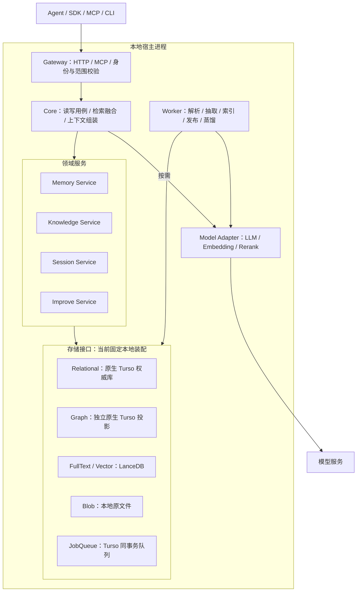

# Origence 记忆与知识统一平台详细设计

> 本文维护架构与领域契约，图示含未实现目标。当前能力见 [STATUS](../../STATUS.md)，接口见 [API](../../API.md)，运行边界见 [OPERATIONS](../../OPERATIONS.md)，验收按 [VALIDATION](../../VALIDATION.md) 中的精确版本判断。

初稿日期：2026-09-22；当前契约核对：2026-10-13
定位：团队 Agent 的记忆与知识库平台，先交付本地存储版本，保留后续服务化能力，Rust 实现。

设计沿用自动发布、tenant/workspace 隔离、来源溯源、删除级联、审计和上下文预算。当前固定本地原生 Turso 权威库与独立图投影、LanceDB 派生全文/向量索引及原文件 Blob，详见 [A2](#storage-design)。仅面向新库；版本升级、旧库兼容和数据迁移不在当前范围，同版本恢复与不兼容库拒绝仍须保证。PG/pgvector 仅为扩展方向。

阅读路径：[产品边界](#1-产品边界) → [架构](#3-总体架构) → [存储契约](#storage-design)。实施顺序见 [产品路线图](../plans/2026-10-09-next-stage-roadmap.md)，身份语义见 [补充规格](2026-10-08-memory-identity-and-context.md)。tenant/workspace 隔离贯穿所有读写，不等待 SaaS 阶段。

---

## 1. 产品边界

### 1.1 做什么

一个支持本地部署的「记忆 + 知识库」平台，目标形成知识导入、事实记忆、会话记录与经验蒸馏的完整闭环：

| 能力 | 含义 |
| --- | --- |
| 知识库 | 资料导入 → 解析分块 → 实体/关系抽取 → 摘要 → 图/向量索引 → 图/向量/关键词混合检索 |
| 记忆事实 | 用户/团队明确表达的事实、偏好、决策、规则，统一证据检索；按配置向量索引，短事实不强制建图 |
| 会话记忆 | 问答经历、使用的证据 ID、反馈、执行轨迹，恢复任务上下文 |
| 经验蒸馏 | 从会话与指导中提炼长期经验，作为文档重新入库建图 |

### 1.2 不做什么

不做 Agent 编排/工具执行、不做通用模型代理、不做互联网爬虫、不做跨后端分布式事务、不做无出处的「经验黑箱」。首版不做 Skill 资产（保留为后续扩展）。

### 1.3 平台设计约束

| 维度 | 本项目 |
| --- | --- |
| 语言 | Rust（复用 Origence 基础） |
| 治理 | 自动发布，但强制保留来源归属 + 删除级联 + 审计（无人工审核门） |
| 存储 | `StorageEngine` 组合 Store trait 与能力声明；当前固定本地装配 |
| 授权 | 原生多 tenant、多 workspace；认证、任务和每条检索分支都贯穿 scope，PG 额外使用 RLS |
| 形态 | 本地存储 + HTTP/MCP，保留服务化扩展 |

---

记忆身份与上下文语义见 [补充设计](2026-10-08-memory-identity-and-context.md)；已交付的显式身份、S2 属性语义、受控模型提取及类型预算统一见 [API](../../API.md)。稳定身份不由相似度自动推断，expected_version 只约束并发版本，不证明事实真假；确定性写入边界见 [S2 契约](../plans/2026-10-11-s2-memory-semantics.md)，真实模型质量按对应验收记录判断。

## 2. 核心概念

平台按对象职责划分，明确这些是**不同生命周期、不同失败语义**的对象，不是同一张 memory 表的标签：

| 对象 | 存什么 | 何时产生 | 后续如何使用 |
| --- | --- | --- | --- |
| 原始资料 Source | 文件、文本、来源及导入元数据 | 用户导入 | 重新解析、版本核查、证明派生知识 |
| 知识产物 Artifact | chunk、summary、entity、relation、向量 | 加工完成 | 找原文、连关系、组合多份证据 |
| 记忆事实 Memory | 事实、偏好、决策、规则 | remember 显式写入 | 检索当前有效且属于该 workspace 的记忆 |
| 会话经历 SessionTurn | 问题、答案、证据 ID、反馈、轨迹 | 每次交互 | 恢复上下文、解释行为、提取经验 |
| 会话指导 Guidance | 目标、规则、偏好、经验、工具使用 | 会话/轨迹分析 | 约束后续回答；过滤后才参与蒸馏 |
| 长期经验 Learning | 蒸馏出的可复用陈述及原因 | improve 蒸馏发布 | 作为文档重新入库建图 |

失败语义举例：会话缓存保存成功 ≠ 长期经验已入库；问答已归档 ≠ 已提炼出可靠经验。每个对象的「已接收 / 加工中 / 可检索」三态必须可分别观测。

---

## 3. 总体架构

模块化单体：单宿主在同一进程运行 API 与一个串行 Worker，共享 `StorageEngine`。权威关系库持有独占 OS 锁，图投影使用独立原生 Turso 文件；进程边界按 [A2.4](#storage-scope) 执行。当前 `Service` 仍持有具体 `LocalEngine` 并返回 `TursoTx`；Store trait 已提供接口基础，应用层尚未完整后端解耦。

下图描述逻辑职责，不代表每个目标均已交付。SessionTurn/Feedback、显式 Improve/Learning 与 EvidenceBundle 已有实现；完整 Guidance 生命周期、自动学习、Rerank 及限流仍是目标。具体范围统一见 [STATUS](../../STATUS.md) 与 [API](../../API.md)。



### 3.1 分层职责

| 层 | 职责 | 不应承担 |
| --- | --- | --- |
| 协议层 Gateway | HTTP/MCP 编解码、认证、输入限制、错误映射、限流、超时 | 资产合并、检索评分 |
| 应用层 Core | 读写用例、跨模块编排、预算、证据契约 | 拼任意 SQL、直接调模型 SDK |
| 领域层 Service | 资产生命周期、证据、冲突、版本、蒸馏规则 | 依赖 HTTP 框架 |
| 基础设施层 Engine | 图/向量/关系/对象读写、能力声明、删除规划 | 绕过领域规则改状态 |
| 后台执行层 Worker | 任务租约、步骤执行、重试、对账、清理 | 绕过 workspace/来源权限 |

依赖方向：协议层 → 应用层 → 领域接口；基础设施实现领域接口。Worker 调用应用/领域服务，不能直接改核心状态跳过发布校验。

### 3.2 存储架构

存储归属、接口与初始化以 [A2 存储设计](#storage-design) 为唯一契约，领域对象映射见 [A5](#a5-完整数据模型与存储归属)。跨库写使用权威关系库账本、幂等与对账收敛，不提供分布式事务或本地/PG 双配置。旧 PG 实现在 Git 提交 `72fb5aa` 保留历史参考。

---

## 4. 数据模型

数据模型采用自动发布，**不设置 `memory_candidates`/`review` 候选与审核中转**，所有对象保留 tenant/workspace 归属。下列名称是逻辑设计，包含 P1/P2 目标，不是已实现 DDL。当前原生 Turso 使用 `oc_` 前缀，所有适配器强制 scope；物理归属见 A5，PG/RLS 仅为未来扩展。

```text
sources            tenant_id, workspace_id, id, uri, content_hash, state
source_versions    source_id, version, content_hash, raw_uri, state
chunks             source_version_id, ordinal, text, content_hash, occurrence, parser_version
summaries          chunk_id, text, model_revision
entities           id, tenant_id, workspace_id, canonical_name, name_hash, type, aliases, description
relations          id, source_entity, predicate, target_entity, fact_text, head_hash, tail_hash
artifact_owners    source_version_id, chunk_id?, artifact_type, artifact_id   -- 溯源
index_entries      artifact_id, field, model_id, dimension, generation, state
memories           id, scope, fact_key, content, valid_from, valid_to   -- P2；P0 记忆复用现有 asset 槽（slot() 以 fact_key 定位/版本追加）
session_turns      session_id, turn_id, question, answer, used_evidence[], feedback
guidance           session_id, type, content, threshold, distilled
learnings          id, statement, why, support_turns[], support_guidance[], publish_state
stage_runs         job_id, stage, idempotency_key, watermark_before, watermark_after, status
audit_events       actor, action, target, details, trace_id   -- 已有
api_keys           id, tenant_id, workspace_id, token_hash, role   -- 已有
```

关键不变量：

1. 一切资产、事件、任务、文件、反馈都带 tenant/workspace。
2. 稳定 ID、索引代、来源版本、发布状态**不混成一个字段**（换 Embedding 模型产生新索引代，而非新业务对象）。
3. 实体稳定 ID = `hash(canonical_name)` 按 tenant/workspace 作用域；块 ID 含 `document_id + content_hash + occurrence`（减少位置漂移）。
4. 一条业务关系可被多份资料支持：关系对象只存一份，来源由 `artifact_owners` 多行支撑（删除时据此区分「移除归属」与「硬删除孤儿」）。

---

## 5. 写路径：add → cognify

### 5.1 接收与登记（add）

`add` 接收资料，解析 tenant/workspace 范围，登记 `sources` + `source_versions` + 一条 job。**导入成功 ≠ 图谱和索引已就绪**。区分新增/重放/更新：同幂等 key 同请求复用，异请求返回 409；内容更新使用独立请求并追加资产版本，不能把幂等冲突当作更新授权。

### 5.2 加工（cognify）

普通文本标准链：解析文档 → 分块 → 并行（抽取实体/关系 + 生成摘要）→ 写入知识产物 → 建索引 → 发布（标记 `ready`）。

- **LLM 抽取返回显式中间结果**（`chunks + summaries + entities + relations + provenance`），不直接写库；由校验、身份解析、归属规划、存储提交逐层处理。
- **自动发布**：抽取通过校验即发布，无人工审核门。但每次发布写审计，且每个节点/边/记忆都挂 `artifact_owners` 溯源。
- **幂等/重试/取消**：保留 job、generation、run_token 和显式重试语义，由 Turso 同事务 JobQueue 实现；领取与恢复见 [A2.5](#storage-queue)。
- **模型降级**：未启用抽取时 `capture` 保留来源、任务明确失败（现有行为保留）。

### 5.3 记忆写入（remember）

结构化记忆 P0 复用「asset 槽」与不可变版本：旧入口按 workspace 内 fact_key 定位，显式入口按 scope + subject + predicate + context 绑定同一资产。后续输入追加版本，受理时接受可选调用方 expected_version，Worker 最终仍复核受理版本；不再强制 review。S2 的 semantic 入口对已登记属性强制版本条件，采用显式 operation/value 路由单值更新、多值补充及不确定证据；不以语义相似授权覆盖。该确定性契约不代表通用自由文本冲突理解。valid_from/to 与 as_of 属 P2。

---

## 6. 读路径：recall

### 6.1 范围解析（目标路由，尚未实现会话范围）

当前 search/resolve 在认证 scope 内检索，可选完整 memory_identity 只保留精确绑定的 memory 并排除知识/图；它不是主体级的混合证据查询。完整身份先定位授权资产，再限定 keyword/vector 候选及 top-k，返回前重新复核可见性；该规则不保证语义召回。下表的 session/dataset/query_type 路由属于后续目标，不是当前 API 字段。

| 调用条件 | 实际范围 |
| --- | --- |
| 有 session、无数据集范围、未指定 query_type | 先会话，命中可跳过图检索 |
| 有 session、有数据集范围 | 会话与知识范围都运行、分别贡献 |
| 其他（含显式 query_type） | 默认 graph 范围 |

「graph 范围」是来源名，不等于只能用图补全；范围内仍可路由到 chunks/hybrid。

### 6.2 三种检索机制

- **Hybrid**：原文 keyword/vector 与启用的摘要分支映射为 chunk 证据后 RRF 融合，按实体名种子扩展一跳关系；身份限定时关闭摘要/图。实际分支与开关见 [API](../../API.md#检索)。
- **GraphCompletion**（P2）：头/边/尾联合评分取综合距离小者；重要性/反馈/可选个性化参与评分。不是「先找相似实体再无脑塞邻居」。
- **范围贯穿**：向量候选、邻居扩展、事实索引、会话历史都要走同一 scope 过滤。

### 6.3 证据契约与预算

已交付的 EvidenceBundle 通过 `/v1/context` 与 MCP `context_bundle` 提供分类型证据和预算；search/resolve 保留既有响应契约。字段、类型开关、冲突边界与引用限制统一见 [API](../../API.md)。

证据必须携带可复核的来源、版本与类型，预算按完整 UTF-8 块保留或丢弃。读取复核已发布版本、未删除资产及有效来源/支持；时间有效性 `valid_from/to` 与 `as_of` 仍属 P2，不能推定已有过期过滤。

---

## 7. 会话记忆与反馈

当前支持调用方显式归档 SessionTurn、实际使用的证据与幂等 Feedback；归档成功不等于已学习。会话读取与上下文纳入规则见 [API](../../API.md)，完整 Guidance、会话向量缓存与自动流程仍是 [A3](#a3-会话记忆与经验蒸馏p1详细设计) 的目标。

目标中的 Guidance 回答使用门槛与长期蒸馏门槛分别维护；它是外部证据，不能提升为系统指令。反馈与图权重跨存储，不承诺全局 exactly-once，需幂等及水位防止重复应用。

## 8. 改进与蒸馏（improve）

当前已实现显式触发的 Improve → Learning 提案、核验与发布最小闭环，条件和支持来源随证据保留，复用现有单 Worker 与知识发布链，不递归触发 improve。接口与取消/重放边界见 [API](../../API.md)；[A3](#a3-会话记忆与经验蒸馏p1详细设计) 的全部八阶段仍是长期目标。

## 9. 删除与一致性

- **provenance 删除规划器**：删资料 A 时先找 A 的产物，区分「仍被其他来源支持」（只移除 A 归属）与「不再被支持」（先移除可检索向量，再硬删图对象）。图对象的来源归属以权威关系库为准。
- **顺序约束**：先提交来源撤回或资产墓碑，检索按 [A2.4](#storage-scope) 立即排除；后台先清除摘要等子对象，再清理对应 chunk，移除 owner 后再删除孤立关系/实体。原始证据按保留策略保留；失败由 [A2.6](#storage-consistency) 账本重放。
- **现有能力继承**：删除墓碑、来源撤回、迟到任务提交阻断、派生索引清理、恢复走追加版本。

---

## 10. 多租户与后续服务化能力

| 能力 | 首版（P0/P1） | 后续（P2） |
| --- | --- | --- |
| 隔离 | 原生多 tenant、多 workspace；认证和所有存储接口强制 scope，RLS 仅适用于 PG | 文档级 ACL、显式跨 workspace 共享 |
| 身份 | tenant/workspace 归属的 API key（token 只存 hash），默认单 workspace scope | OIDC/SSO、细粒度角色、显式跨 workspace 授权 |
| 审计 | 现有 `audit_events` | 审计查询 API |
| 运维 | 已实现输入限制与模型调用超时；请求限流尚未实现 | 配额、公平调度、分页游标、可观测指标 |
| 计费 | 预留 `usage` 埋点字段 | 计费编排 |

---

## 11. 交付阶段

| 阶段 | 范围 | 验收必须看什么 |
| --- | --- | --- |
| **P0 知识可用且可治理** | Turso/LanceDB/Turso 图本地闭环、自动初始化、可扩展接口；普通文本入库、稳定分块、keyword/vector 检索、自动发布、溯源 + 撤回、作业重试、workspace/tenant 隔离；图谱先完成可靠写入和删除 | 原文证据正确；撤回后立即不可检索；共享来源删除正确；重试不产生重复版本；部分存储失败可重试或明确进入 orphan |
| **P1 会话到长期记忆** | 会话问答、指导、反馈、经验蒸馏、水位、阶段化 improve | 新经验何时可见；哪些经验被拒；反馈准确关联且幂等 |
| **P2 增强与商业化** | GraphCompletion、个性化、时间冲突、本体/代码/结构化专用路径、OIDC、配额计费、可观测、Neo4j/Qdrant 生产适配 | 独立消融显示收益；成本延迟符合预算；不破坏权限与溯源 |

---

## 12. 评测与验收

评测方法见 [效果评估标准](../../Origence_效果评估与对比标准.md)，治理验收按 A1 自动发布及 [A2.8](#storage-acceptance)。S1 已完成 300 题工程检索实验，但不等于覆盖该标准的全部企业生命周期与 Agent 任务；新增题目独立复核仍待完成。分数和限制统一见 STATUS/VALIDATION，不在设计中重复维护。

上线前必须验证以下三条关键假设：

1. **图是否带来有效证据而非只增加 token**——同一查询分别跑原文检索 / 原文+摘要 / 再加实体关系，比正确证据覆盖与噪声。
2. **实体名称合并是否足够**——同名团队/项目、别名、简称、跨 workspace 数据测误合并率；不够就退回更保守的身份策略。
3. **蒸馏是否保留条件**——「仅本次」「仅测试环境」等反例不能被错误推广成长期规则。

---

## 13. 风险与边界

1. **Rust 的 LLM/图生态弱**：用 reqwest 调 `/chat/completions` + JSON schema 校验，抽取走显式中间结果，不依赖 Python 生态；代价是 prompt/结构化输出/重试要自己写。
2. **本地后端验收边界**：当前工具链为 Rust 1.98.0，平台与 release 验收按 VALIDATION 的对应提交记录判断。关系库锁约束单宿主，图替换后仍不能恢复为两个应用进程直接打开同一数据目录。
3. **自动发布 vs 治理**：去掉了人工审核门，靠溯源 + 删除级联 + 审计兜底；不承诺「自动抽取即事实正确」，原文证据始终可回查。
4. **跨存储一致性**：无统一事务，靠产物账本 + 幂等重试 + 对账收敛；不承诺 exactly-once。
5. **多 Worker 并发**：本地初期以 OS 文件锁限制单 Worker，保证崩溃释放与遗留任务恢复；旧 PG/Apalis 的会话锁仅属于历史实现。

---

## 14. 关键决策记录

| 决策点 | 结论 | 理由 |
| --- | --- | --- |
| 技术栈 | Rust | 复用 Origence 早期 API/Worker/RAG/RLS 基础 |
| 治理模型 | 自动发布 | 去掉人工审核门；保留溯源/删除/审计 |
| 存储 | 本地原生 Turso 权威库/图投影、LanceDB 全文/向量、Blob；接口保留扩展 | PG/pgvector 仅预留扩展，不阻塞本地交付 |
| 初始化 | 自动创建新库，无版本化升级 | 不修改已有不兼容结构，启动检查失败时明确报错 |
| 交付形态 | 本地存储平台，后续可服务化 | HTTP + MCP，所有后端统一 scope 隔离 |
| 架构 | 模块化单体（API + 单 Worker） | 本地同进程共享引擎，接口边界保留后续扩展 |

---

# 附录：详细设计（A1–A6）

以下六节展开产品与存储契约。A1/A2/A5 维护当前治理与存储边界；A3/A4 保留尚未全部实现的 P1/P2 目标，不能作为接口可用性的证明；A6 指向唯一 API 清单。历史实施计划与验证记录按当时版本阅读。

## A1. 自动发布详细设计

### A1.1 变更目标与影响面

自动发布已实施：去除候选/审核中转，writer 授权的记忆及 capture 结果经任务发布；旧 review 接口已移除。

### A1.2 数据模型变更

新库不含候选/审核表及 review_id，不自动修改旧库。publish_if_authorized 仅兼容接受，不参与授权或发布逻辑。

### A1.3 写路径

memory：来源 → publish；capture：来源 → 抽取 → 逐条发布记忆；knowledge：来源 → ingest → publish。显式身份及 expected_version 行为以 [API](../../API.md) 为准。

### A1.4 worker 变更

抽取结果逐条保留 fact_key、asset 和 expected_version，经领域事务与账本发布，不能把不同事实拼成单一文档。

### A1.5 保留的治理

直接发布仍需审计、每个版本/图对象的来源归属、撤回级联和幂等；发布前复核权限、版本与任务状态，不以模型输出代替授权。

---

<a id="storage-design"></a>

## A2. 可插拔存储与自动初始化完整设计

本节是存储的唯一设计契约，与正文第 3、4、5、6、9、11 节共同约束实现。独立 storage 设计已合并，不再维护第二份规范。

<a id="storage-target"></a>

### A2.1 已确认目标与当前状态

当前固定使用 **Turso Database 0.8.2 原生 Rust 引擎 + LanceDB 0.40.0 + 本地 Blob**，数据库嵌入应用，不另部署数据库服务。关系和图均经 `native_turso` 适配器使用原生引擎，不使用 SQLx SQLite 或 libSQL；精确依赖以 Cargo.toml/Cargo.lock 为准。

| 存储面 | 当前实现与责任 |
| --- | --- |
| 权威关系与队列 | `context.db`：权限、来源、版本、身份、summary、owner、账本、审计及同事务队列 |
| 原文 chunk 全文与向量 | `vectors/`：LanceDB 原生 BM25/AND FTS 与过滤向量检索；满足已冻结条件时使用 ANN，否则 exact |
| 图投影 | 独立原生 Turso `graph.db`：实体、关系与遍历；不能代替 `context.db` 的 owner/可见性权威 |
| 原始文件 | `blobs/`：保留上传原文件；归属与生命周期元数据由 `context.db` 管理 |

Summary 文本留在 Turso，由应用按同一 chunk 的多条摘要行聚合词项后执行 AND；不使用 Turso FTS，也不混入 LanceDB 原文 chunk FTS。分词、ANN 路由及失败边界见 [API](../../API.md#检索) 与 [OPERATIONS](../../OPERATIONS.md)。PostgreSQL/pgvector 仅为未来适配方向，不要求当前提供 PG 配置。构建、隔离与恢复证据按 [VALIDATION](../../VALIDATION.md) 的精确版本判断。

未来新增后端只改变存取实现，不改变 tenant/workspace、来源有效性、发布、撤回和幂等契约。切换配置不搬运已有数据，不提供后端间数据转换或历史库升级。

<a id="storage-interfaces"></a>

### A2.2 接口边界

`StorageEngine` 组装 `RelationalStore`、`JobQueue`、`VectorStore`、`GraphStore`、`BlobStore`。首个实现固定装配本地后端，未来通过适配器扩展 PG。目标是领域层不接触数据库 SQL/厂商类型；当前具体类型绑定见第 3 节，不能把接口存在等同于完整后端解耦。

- `RelationalStore`：提供带 scope 的业务事务，涵盖来源、资产、版本、身份复核、幂等键、审计、作业登记及账本。用领域操作表示读写，不能用通用 SQL 执行接口代替抽象。
- `JobQueue`：领取、提交确认、重试、取消、崩溃恢复；业务写入与入队必须处在同一关系事务中。本地 Turso 适配器使用同库队列表；未来 PG 扩展也须满足同事务入队，是否复用 Apalis 留待该扩展实现时决定。不能把“写业务”和“入队”拆成两个无补偿操作。
- `VectorStore`：当前同时承载原文 chunk 全文与向量派生索引；按 scope、完整来源版本和 generation 管理，向量另按 embedding profile/维度隔离；声明过滤 ANN、精确搜索及一致性边界。
- `GraphStore`：实体/关系写入、一跳或多跳遍历、按来源清理。声明最大遍历能力、原生 scope 过滤及共享 owner 删除能力。
- `BlobStore`：按 scope 写入、读取、删除原始文件；key 不接受任意系统路径。

所有业务接口必须接收不可省略的 `Scope { tenant_id, workspace_id }` 或已授权的 scope 事务。认证前查 token、平台管理员建 workspace、全局任务领取属于显式的特权接口，不得复用为普通业务查询。

#### 事务与入队的调用边界

关系适配器创建持有 scope 的领域事务；事务同时暴露业务登记和 enqueue 操作，JobQueue 的消费者接口负责 claim/ack/retry，不自行在第二个连接上入队。以下为调用顺序示意，不是已实现的 Rust API：

```text
tx = relational.begin(authorized_scope)
tx.check_current_permission(permission)
tx.begin_command(principal, operation, idempotency_key, request_hash)
tx.record_source_and_job_payload(input)
tx.enqueue(work_item)
tx.audit(action)
tx.finish_command(response)
tx.commit()             # 任一步失败则共同回滚；不在事务内调用模型
```

`DomainTx` 定义领域事务接口；当前具体事务由 `TursoTx` 实现。GraphStore/VectorStore/BlobStore 不接收数据库事务；跨库写通过 A2.6 的账本编排。VectorStore 查询参数同时包含 scope、profile、dimension、generation，不能只传一个裸向量。

<a id="storage-initialization"></a>

### A2.3 初始化生命周期

各后端实现 `initialize()` 与 `check()`。新库创建当前完整结构，并写入引擎/角色/schema 格式标记；这些标记用于准入检查，不是升级或迁移机制。既有非空 Turso 文件在可写打开前只读检查格式与 schema，缺对象或不兼容即失败，不补表、不转换、不覆盖。

当前 `Service::open` 初始化并检查存储，恢复任务并进行账本对账与孤儿清理；已发布内容依赖的 LanceDB 表/schema/FTS 索引也须通过健康检查。新库已含身份、S2、Session 与 Learning 结构；历史 `memory-identity-upgrade` 命令仅保留同版本只读检查，不能安装旧库身份表，操作说明见 [OPERATIONS](../../OPERATIONS.md#显式启用记忆身份)。

当前关系与图 schema 仍位于 `src/storage/sqlite-schema.sql`、相邻领域 schema 及 `sqlite-graph-schema.sql`，模块路径和 `SqliteStore`/`SqliteTx` 等兼容别名不代表 SQLite 引擎。原生 Turso 连接使用外键检查与 busy timeout；租借归还、取消清理、shutdown 和整目录/WAL 备份边界统一见 [OPERATIONS](../../OPERATIONS.md)。

多存储初始化不能共享事务；在全部后端检查成功前，不启动 HTTP ready、任务消费或发布。失败后可重启并复用已经成功初始化的后端，初始化不得破坏已有业务数据。

<a id="storage-scope"></a>

### A2.4 多租户隔离与检索可见性

所有对象 ID、唯一约束、owner、缓存与文件 key 都包含 scope。Turso 所有领域 SQL 在适配器内显式绑定 tenant/workspace；禁止返回一个忽略 scope 的裸事务作为隔离保证。未来 PG 扩展须使用同样的接口约束，可额外使用 FORCE RLS 作为第二层保护。

LanceDB 全文/向量与 Turso 图查询必须在候选产生时限定 scope，不能先全库取 top-k 再过滤。LanceDB 排名前核验授权候选的完整来源身份，排名后由新权威快照复核参与排名的发布身份；身份缺失、错配或并发撤回须明确失败，不静默缩短结果。ANN 与 exact 都受同一权限、来源和 generation 约束；不存在 Turso/LanceDB 共同事务快照，具体错误契约见 [API](../../API.md)。

本地进程访问约束：

- 关系适配器持有数据目录的独占 OS 文件锁，第二个宿主在打开关系库时被拒绝；图适配器不另设宿主锁。
- 本地 API 与 Worker 在一个应用宿主内共享 `StorageEngine`，直接调用库，不另设数据库服务。独立 CLI/MCP 通过宿主应用接口访问运行中的数据集；离线打开要求独占目录。
- 图适配器使用原生 Turso 连接租借池，在 `graph.db` 写入确定性实体/关系 ID；查询带 scope，实体删除外键级联清理关联边。它与权威库没有共同业务事务，发布仍由权威 owner/账本决定。
- LanceDB 默认不刷新其他进程提交的更新；本地适配器显式设置 `read_consistency_interval(Duration::ZERO)`。适配器级可见性测试不授权多个应用宿主并发打开同库，也不代表跨存储事务原子性。

关系库是最终可见性的权威：每条返回的 chunk、summary、entity、relation 都必须有仍有效的 owner/source、已发布版本和未删除资产。图/向量索引命中不能直接返回；撤回事务一旦提交，后续查询立即不可见，不等待异步物理清理。多个有效来源共享的图对象只移除被撤回的 owner。

<a id="storage-queue"></a>

### A2.5 队列并发与恢复

保留单 Worker 约束。Turso 关系适配器采用与数据库路径绑定的 OS 文件锁，进程退出释放；不把持久化 holder 字段当作进程锁。持锁失败即退出，无法持续确认持有权时停止领取与提交。

Turso 业务写事务从开始就使用 `BEGIN IMMEDIATE`，不能先 BEGIN 再嵌套 BEGIN。claim 在短事务内按完整复合键更新任务，递增 run_token 并携带 generation；模型/文件 IO 在事务外执行。提交再次校验 scope、generation、run_token、权限、来源和取消状态。

取得独占 Worker 锁后先回收上次进程遗留的 processing 任务；数据库错误进入有 attempt、next_retry_at 和上限的 retry_wait，不能仅 sleep 后遗忘任务。重试不重复发布，provider 错误仍需显式重试。取消/重试推进 generation，使旧执行结果失效。当前本地宿主使用 Turso 自轮询队列和单 Worker；未来 PG 扩展通过同一恢复契约验收。

<a id="storage-consistency"></a>

### A2.6 跨存储一致性

产物账本位于关系库，主键包含 scope、对象/来源版本、存储面和 generation；记录 pending、retry_wait、committed、orphan、attempt、last_error、next_retry_at。

1. 业务事务登记目标版本、作业、待写产物与幂等键。
2. 同一个串行 Worker 按保存计划幂等写入全文、向量与图；全文/向量保留完整发布身份，图发布由权威 owner 与含 generation 的账本约束。
3. 原生写全部成功后，权威事务重新检查权限、取消、来源、预期版本、generation 与 run_token，将版本、owner、ready 索引、committed 账本及任务完成一起提交；失败与迟到产物通过重放和对账收敛。
4. 删除先提交墓碑使检索不可见，再删除摘要等依赖对象、撤销 owner、清理孤儿和向量；共享来源对象保留。

不承诺不同存储面的原子提交；已实现的发布计划、账本、串行清理与启动对账负责收敛，具体恢复和重试边界见 [API](../../API.md#任务与读取可见性)。

<a id="storage-configuration"></a>

### A2.7 配置和能力降级

当前固定装配 [A2.1](#storage-target) 的本地后端，不提供 `local|postgres` 双配置或尚未实现的后端开关。配置、目录布局、CLI/MCP 在线访问与离线独占步骤统一见 [OPERATIONS](../../OPERATIONS.md)。未来适配器通过契约验收后才能增加配置入口。

启动时未知后端或缺依赖即失败，禁止静默切回 PG。查询明确请求缺失能力时返回 Unavailable；只有 allow_partial 才能降级，并返回 effective_mode、warnings、实际索引就绪状态。后端不存在与模型临时失败分开报告。

| 能力缺失 | 处理规则 |
| --- | --- |
| 多跳遍历 | 关闭依赖多跳的路径；仅在请求允许且一跳能力存在时降级 |
| 过滤 ANN | 若实现支持带 scope 的精确查询可使用精确查询，否则返回 Unavailable |
| 后端原生共享来源删除 | 由关系库 owner 与清理规划器实现语义，不能直接删除共享对象 |

能力缺失不能削弱 tenant/workspace 或来源有效性；这两项不允许降级。

<a id="storage-acceptance"></a>

### A2.8 验收

- 自动初始化：空库成功、重复和并发启动不重复建表、事务失败回滚、旧/部分结构拒绝且数据不变、无升级历史表。
- 本地后端跑 scope 合约测试；未来 PG 扩展复用同一套测试，覆盖跨 tenant、同 tenant 不同 workspace、相同对象 ID/fact_key、撤销 key 和直接对象查询。
- 队列覆盖业务/入队共同回滚、进程强退恢复、第二 Worker 拒绝、数据库错误重试、取消、generation/run_token 和迟到写入。
- 全文、向量与图覆盖检索前后可见性、共享 owner、摘要删除顺序、部分写入失败、重启对账和幂等重放。
- 本地后端需实测目标 OS 上原生 Turso/LanceDB 的构建、锁、第二宿主拒绝及最低 Rust 版本，再标为已支持。

新增后端先验证构建、scope、事务及进程访问，再接入应用；不要求先实现 PG。后续工作统一见 [产品路线图](../plans/2026-10-09-next-stage-roadmap.md)。

---

## A3. 会话记忆与经验蒸馏（P1）详细设计

本节保留完整目标模型与流程，并非当前实现清单。已交付 SessionTurn/Feedback、显式 Improve/Learning 与 EvidenceBundle 的接口和限制见 [API](../../API.md)；下列 Guidance、会话向量缓存、自动触发及反馈调权不能据此视为可用。

### A3.1 数据模型

```text
session_turns: (tenant_id, workspace_id, session_id, turn_id, question, answer, used_evidence JSON, feedback JSON, created_at)
guidance:      (tenant_id, workspace_id, id, session_id, type, content, distilled boolean, created_at)
learnings:     (tenant_id, workspace_id, id, statement, why, support_turns [UUID], support_guidance [UUID], publish_state, created_at)
stage_runs:    (tenant_id, workspace_id, job_id, stage, idempotency_key, watermark_before, watermark_after, status)
```

`used_evidence` 存实际使用的图节点/边 ID 与 chunk ID；`feedback` 存对证据的帮助程度。

### A3.2 SessionManager 流程

保存问答 → 记录 `used_evidence` → 尝试建 `session_qa` 向量索引（失败记录不阻塞）→ 准备下次上下文（近期问答 + 会话向量召回去重）。会话缓存不可用时降级到近期历史。

### A3.3 improve 有序阶段

```
反馈调权 → 问答持久化 → 轨迹持久化 → 轨迹提炼指导 → 经验蒸馏 → 用户偏好更新 → 三元组增强 → 全局上下文索引
```

- **致命阶段**：仅「问答持久化」失败终止流程；其余阶段报错记录后继续，返回逐阶段状态。
- **水位**：`stage_runs.watermark_after` 记录每阶段已处理到的游标；重试从水位续跑，不重复应用反馈。
- **触发**：条数/时间阈值在写入调用时判断；会话在阈值前结束由应用显式 `flush/improve`。

### A3.4 蒸馏接受标准

从合格 guidance + 问答时间线提案 → 查相似旧经验与实体名 → 二次 LLM 判断三判据：**新颖、持久、有依据**。接受后写成文档走 `add/cognify` 入库（**不递归 remember/improve**），并保留 `learnings.support_turns`/`support_guidance` 证据链。

---

## A4. P2 增强设计

| 增强 | 设计要点 |
| --- | --- |
| GraphCompletion | 头/边/尾联合评分：`score(rel) = α·d(head) + β·d(edge) + γ·d(tail)`，取综合距离小者；重要性/反馈/可选个性化参与；缺边有惩罚项。该公式是 P2 设计候选，权重与惩罚项须通过同预算消融验证后确定 |
| 个性化 | 按 principal 记录偏好权重，参与 GraphCompletion 评分；不改变权限边界 |
| 时间冲突 | 记忆带 `valid_from/to`，查询带 `as_of`；冲突按时间窗口取有效值，不做全局唯一真相 |
| 专用解析器 | 代码/DLT/结构化数据走各自提取器，输出同一套 `GraphExtraction` 中间结果 |
| SaaS 完备 | OIDC/SSO、审计查询 API、分页游标、租户配额与公平调度、计费编排、可观测指标（延迟/吞吐/费用埋点） |

---

## A5. 完整数据模型与存储归属

以第 4 节逻辑模型和 [A2](#storage-design) 为准。下列名称是领域对象，不是可直接执行的 DDL。所有业务身份包含 tenant_id/workspace_id；对象 ID、来源版本和索引 generation 分开管理。

| 本地存储 | 对象与责任 |
| --- | --- |
| Turso `context.db` | workspaces、api_keys、events、files 元数据、assets、versions、chunks、summaries、jobs、commands、audit；来源有效性与发布状态的权威 |
| Turso `context.db` | artifact_owners、index_entries、artifact_ledger；全文/向量/图来源归属、写入进度、清理与对账状态的权威 |
| Turso `graph.db` | entities、relations 及遍历所需 scope/来源投影；不能取代 `context.db` 的可见性复核 |
| LanceDB | 原文 chunk FTS 和向量派生条目，带 scope、artifact_id、完整来源版本与 generation；向量按 profile/维度隔离 |
| 本地 Blob | 原始文件正文，Turso 保存文件归属与生命周期元数据 |
| Turso `context.db` | 已交付 SessionTurn、Feedback、Improve/Learning 的档案、支持与水位；A3 的完整 Guidance/阶段模型仍是目标 |

P0 记忆仍使用资产槽与版本；候选/审核功能已在自动发布阶段移除，并直接更新新库完整初始化定义，不升级旧库。实体与关系 owner 的逻辑语义统一归属关系库；Turso 图中必要的冗余投影由账本对账，不以其状态单独判断可见性。

权威关系表使用 `oc_` 前缀；UUID 为 16 字节 BLOB，JSON 为 TEXT，布尔和 Unix 毫秒时间为 INTEGER；复合 scope 主键/外键和初始化定义见 A2.3。当前本地适配器无 RLS，所有领域操作显式绑定 scope。历史 PG 的 oc.* schema/jsonb/RLS 不属于当前运行实现。

---

## A6. 完整 API 契约

[API](../../API.md) 是已交付 HTTP 行为的唯一清单，包含权限、幂等、版本、错误、显式身份及 AML 适配；本设计不再重复路由表。旧 candidates/review 接口已移除。

MCP 的四个只读工具及已交付 Session/Feedback、Improve/Learning、EvidenceBundle 接口统一见 [API](../../API.md)。本设计中的目标流程不能增加路由、工具或权限承诺。
