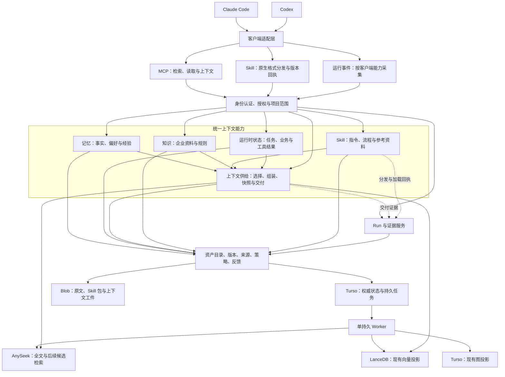

# Origence · 企业 Agent 数据底座架构规划

版本：v0.2 · 2026-11-16 · **待产品确认，尚未实施的目标架构**。

本版按已确认的概念层级修订：**上下文包含记忆、知识、Skill，以及任务状态、业务状态、工具结果等；
可观测性贯穿这些上下文的供给与使用过程。** 后续部署、作者工作流与交付细节仍待确认。

本文是本次产品范围与目标架构的唯一评审入口。已确认的方向、建议采用的设计和现有代码分别标注；
确认本文后，再将阶段交付拆成实现合同。当前实现以[平台设计](2026-09-22-memory-knowledge-platform-design.md)、
[STATUS](../../STATUS.md)和 [API](../../API.md)为准，本文不新增可用接口或部署保证。
核对基线为 Origence `17fa39582aefb2c53165fae62bf8c41de4aab34c`；
AnySeek 已有集成证据使用 `6614bbf29bad0041c65738831bc1a16da4c69660`，不代表其他版本已验证。

## 1. 定位、用户和成功标准

**Origence 是企业内部 Agent 的统一上下文数据底座：统一管理记忆、知识、Skill 和运行时状态，
按任务提供上下文，并追溯其交付、加载、引用、工具调用和任务结果。** AnySeek 是其中的检索与索引底座。

首批用户是研发团队与业务团队；首批客户端为 **Claude Code 和 Codex**。同一团队可使用多个 Agent，
同一 Agent 也可通过不同客户端运行。客户端负责模型调用与任务执行，Origence 提供资产治理、
授权检索、上下文交付和执行证据。业务团队可先通过这两种客户端使用经批准的资料和业务工具，
后续再按需求接入其他 Agent 平台。

成功标准是：一个有权限的员工或受托 Agent，能获得适用于当前任务的有效数据和 Skill；
完成任务后，团队能核验“当时交付了什么、加载了什么、调用了什么、结果如何”，并知道记录缺在哪里。
平台价值同时用研发任务和业务任务验证，不能仅以搜索命中率或调用量判断。

### 1.1 已确认范围

| 项目 | 已确认决定 |
| --- | --- |
| 服务对象 | 企业内部研发团队、业务团队的多种 Agent |
| 首批客户端 | Claude Code、Codex；替代此前“首版仅 Claude Code”的目标范围 |
| 上下文层级 | 记忆、知识和 Skill 是上下文的组成部分；任务状态、业务状态和工具结果等也属于上下文 |
| 核心能力 | 统一上下文的资产管理与供给，以及贯穿其生命周期的 Agent 可观测性 |
| Skill 第一阶段 | 可复用指令、流程与参考资料；版本管理和分发 |
| 可观测性第一阶段 | 追溯数据、Skill、工具和任务结果 |

### 1.2 本规划的产品边界

第一阶段提供记忆、知识、Skill 等上下文的管理与供给，并建立最小运行证据链。
通用 Agent 编排、模型托管、沙箱执行、业务工具凭据托管、
全量 APM/成本计费平台、完整 SaaS 控制面另行立项。Skill 可以声明依赖工具，但工具执行及授权仍由执行端负责。
未来允许替换或扩展检索适配器，当前不承诺把全部存储搬入 AnySeek。

## 2. 总体架构与责任边界

建议先沿用单 Origence 宿主与单持久 Worker，AnySeek 独立服务。
统一上下文能力内部按记忆、知识、Skill、运行时状态和供给职责划分模块；可观测性贯穿这些模块。
业务资产版本和访问决策由 Origence 权威库统一管理，无需将各模块立即拆成微服务。



图中 Skill 服务、Run 服务、上下文快照和客户端采集属于目标能力；当前 MCP 与既有知识/记忆模型继续复用。
所有检索候选返回前仍由权威库复核，不以索引记录或客户端声明直接决定访问权限。

### 2.1 Origence 与 AnySeek 分工

| 领域 | Origence 负责 | AnySeek 负责 |
| --- | --- | --- |
| 企业数据接入 | 连接来源、权限映射、解析、原文与版本、更新/删除同步 | 接收标准 Record 并维护索引 |
| 身份与治理 | 员工/服务身份、受托 Agent、workspace/project、资产 ACL、生命周期 | 通用 Tenant 隔离和 metadata 过滤；不解释员工权限 |
| 检索 | 查询范围、候选身份、版本/来源复核、引用、预算和上下文选择 | 全文、向量/混合候选与排序能力，按实际接入逐项验收 |
| Skill | 作者与发布权、不可变版本、兼容性、分发、停用与使用证据 | 按需索引 Skill 描述与参考资料；不执行或授权 Skill |
| 可观测性 | Run/事件合同、证据关联、结果反馈、覆盖率与查询 | 需要时索引可搜索的脱敏记录；不作为唯一事件权威库 |
| 一致性与恢复 | 业务幂等、发布账本、原计划重试、撤权优先、最终复核 | 稳定 Record/group、条件写入、幂等结果与后端恢复 |

**当前只接入 AnySeek 全文。** 向量仍在 LanceDB；AnySeek 向量/混合接入必须单独验证模型 profile、
dimension、过滤、版本和故障行为，再决定切换。现有全文词项编码不保证与本地 BM25 排序相同。
AnySeek 同 Tenant 的普通 key 不能替代员工或文档 ACL，服务凭据只由 Origence 宿主持有。

### 2.2 各仓近期工作

Origence 优先完成：两种真实客户端接入、可信身份与项目映射、上下文快照、最小 Skill 发布/分发、
最小 Run 证据链、来源更新和撤权同步，以及研发/业务各一个试点。

AnySeek 优先提供并验证：现有全文写入/查询合同的稳定性、批次边界与错误分类、重开恢复、
索引配置可核验性、过滤条件和实际负载表现。现有 info 对 tokenizer/stop_words 和凭据 Tenant
等价性未提供充分证明，需补能力或明确部署核验约束。向量/混合检索按试点需要推进。
这些是需协同确认的后端工作，不表示本次已修改 AnySeek 或已完成性能验收。

## 3. 上下文能力体系与共用基础

产品层级如下；记忆、知识与 Skill 均属于上下文。上下文供给负责选择和交付这些内容，可观测性负责记录其流转与结果。

```text
Origence · Agent 数据底座
├─ 统一上下文能力
│  ├─ 上下文资产与状态
│  │  ├─ 记忆
│  │  ├─ 知识
│  │  ├─ Skill
│  │  └─ 任务、会话、业务、环境、工具结果与交接状态
│  └─ 上下文供给：发现、选择、组装、快照与交付
├─ Agent 可观测性：关联上下文、工具和任务结果
└─ 共享治理：身份、权限、版本、来源与生命周期
```

| 上下文内部职责或贯穿能力 | 对使用者提供的能力 | 第一阶段的具体产物 |
| --- | --- | --- |
| 记忆管理 | 管理有主体、范围和适用条件的事实、偏好、决策与经验 | 复用已有显式身份、语义更新、冲突证据和受控 Learning |
| 知识管理 | 接入、更新、搜索、读取和引用企业资料 | 有来源和不可变版本的知识资产、可撤回检索投影 |
| Skill 管理 | 发现、审阅、发布、分发、固定版本、停用程序性上下文 | 指令/流程/参考资料包、manifest、摘要校验、客户端加载回执 |
| 运行时状态管理 | 管理任务、会话、业务状态、工具结果与交接 | 有来源、时效和范围的类型化条目及受控引用 |
| 上下文供给 | 按当前任务、权限、时效和预算选择上述内容，支持继续工作与交接 | 任务输入快照、多通道交付清单、缺失/过期/冲突说明 |
| 可观测性（贯穿） | 查询上下文供给与任务结果，解释记忆、知识、Skill 等的可见贡献 | Run、Step、事件、证据链接、结果/反馈、采集覆盖说明 |

共同基础包括身份与授权、资产目录与版本、来源与定位、保留与删除策略、项目归属、审计与评估。
模块间通过稳定 ID 和不可变版本关联；先复用现有来源、发布、会话及反馈合同，再补新增领域对象。

### 3.1 上下文的组成与运行实例

| 概念 | 在体系中的位置与作用 | 例子 |
| --- | --- | --- |
| 上下文 | 总概念：Agent 理解任务、作出判断和行动所需的信息、规则、程序性指引与状态 | 包含下述记忆、知识、Skill 和运行时状态 |
| 记忆 | 上下文组成：按主体、项目和适用条件保留的事实、偏好、决策与经验 | 项目约束、用户已确认的偏好、审阅后的处理经验 |
| 知识 | 上下文组成：企业可使用的资料、规范和业务事实 | 退款政策 v3、接口规范、经过授权的客户记录 |
| Skill | 上下文组成：可复用的指令、步骤、流程与参考资料，指导如何执行任务 | 工单诊断步骤、报告模板、代码评审检查流程 |
| 运行时状态 | 上下文组成：当前任务及环境中持续变化的输入、中间状态与结果 | 这张工单、用户批准范围、测试结果、交接包 |
| 运行时上下文实例 | 本次任务实际选取并通过各通道提供的上下文子集 | 记忆条目 + 知识片段 + Skill 版本 + 当前工单状态 |
| 运行证据 | 贯穿上下文流转的观测记录，用于核验发生了什么 | 已交付输入、加载的 Skill 版本、工具结果和最终工件 |

记忆、知识和 Skill 在进入具体任务前就属于平台管理的上下文资产；选入任务后产生该次运行的供给关系，
原始资产版本不会因此变更。资产管理与运行时选择/组装是上下文能力内的不同职责。
Skill 可通过客户端原生机制加载，知识可通过 MCP 按需读取，二者共同属于上下文供给，
无需全部拼进同一段 prompt。运行时实例与快照按实际交付通道分别记录内容或版本引用。
历史 Run 只能经受控筛选形成经验，不能因为任务“成功”就自动变成公司事实或新 Skill。
现有 `MemoryIdentity.context` 表示一个事实身份的显式适用条件，不等于本规划的整份任务上下文，
两者不能直接共用字段或用任务摘要替代完整身份匹配。

## 4. 上下文数据：范围、来源和生命周期

上下文包括**记忆、知识、Skill 和运行时状态**。平台既管理可复用的上下文资产，
也管理任务内持续变化的信息，再按身份、项目、时间和权限为具体任务选择与交付。
数据类型决定其更新、时效、保留和交付方式；先接试点确实需要的部分。

### 4.1 数据分类

| 类型 | 具体内容 | 典型来源 | 时效与保留建议 |
| --- | --- | --- | --- |
| 记忆 | 按主体与条件保留的事实、偏好、已确认决策、历史经验 | 显式写入、受控提取、已审阅 Learning | 区分个人/项目/团队范围；更新留版本，撤回支持来源时失效 |
| 知识 | 文档、规范、接口定义、产品规则、业务资料与事实 | 文件上传、Git、内部文档和业务连接器 | 固定来源/版本，保留引用；同步内容/权限/删除并在交付前复核 |
| Skill | 指令、步骤、流程、模板、参考资料及适用条件 | Git 作者流程、Skill 注册与发布 | 不可变发布版本；记录分发/加载状态、兼容性和撤销边界 |
| 任务与会话状态 | 目标、约束、输出要求、验收条件、相关问答、批准范围、当前步骤与待办 | 用户输入、任务系统、当前会话、客户端 | 通常为任务/会话；摘要关联来源，计划与已执行事实分开 |
| 业务与环境状态 | 工单/订单/客户现状、指标、仓库/commit/差异、环境、项目背景 | 经授权的业务工具、本地客户端、项目配置 | 标记观测时间和刷新要求；源系统保留真值权威，工作区变更可使输入过期 |
| 工具与协作信息 | 工具说明/I/O schema、调用结果、测试/文件/报告工件、其他 Agent 的交接包 | 客户端工具声明、实际调用、显式授权交接 | 有界保留摘要或工件引用；限定共享范围；声明不授予工具权限 |

记忆、知识与 Skill 是明确的上下文类型，其余类型可按任务进一步细分。同一来源可支持多类内容，
分类不替代其来源、生命周期或权限规则；会话结论和工具结果需经受控确认才能发布为可复用记忆或知识。
身份、授权范围、项目、来源与时效是各类上下文共同的治理维度。
“身份与授权背景”包括服务端可信的访问决策，以及可交付给 Agent 的有限背景说明。
请求中的 `project_id`、角色文字或工具声明只能缩小意图，不能扩大服务端派生的权限。
访问令牌、密码、私钥等不作为上下文资产保存；本地整个仓库和全部聊天记录也不默认上传。

### 4.2 时间、真实性与冲突

每个条目建议包含 `observed_at`、必要时的 `valid_from/valid_until`、来源更新时间、获取方式和状态。
业务系统支持历史版本时记录其版本；不支持时明确“在某时观测到”，不能伪造可重复的 as-of 查询。
TTL 由数据类型与试点需求确定：库存和工单状态通常需要重新查询，已发布规范可固定版本，
用户批准与执行许可则在动作前按当前条件核验。

区分来源事实、用户声明、客户端报告、模型摘要/推断和已确认决策。保留缺失、过期和相互冲突的输入；
不以较新时间或相似文本直接判定谁为真。当前代码的冲突检测限于明确身份和已登记的单值属性，
新增类型不能默认获得通用事实核验能力。

### 4.3 保存分层与受控沉淀

| 层次 | 保存对象 | 规则 |
| --- | --- | --- |
| 请求/Run 临时态 | 当次任务输入、短期工具结果、预算内中间状态 | 有界、可过期；不进入全公司检索 |
| 会话/项目共享态 | 已确认决策、交接包、项目约束 | 显式范围与责任人；重新读取仍校验授权 |
| 长期资产 | 正式知识、确认记忆、已发布 Skill、审阅后的经验 | 有版本、来源、发布权、撤回和保留规则 |
| 审计证据 | 输入清单、必要快照、Skill 摘要、工具事件、结果引用 | 按策略脱敏和保留；访问记录不能绕过原数据权限 |

“临时结果 → 长期记忆/知识/Skill”必须经过提议、来源核验和获准发布；默认不自动沉淀。
不同层可使用同一 Blob 引用，但保留与访问必须按依赖关系计算，不能仅删除索引就声称正文已清除。

### 4.4 类型化条目和输入快照

以下是建议的领域合同，不是当前 API 字段；具体 schema 在确认后设计：

| 对象 | 建议字段与含义 |
| --- | --- |
| ContextItem | 记忆/知识/Skill/运行时状态等类型、内容或受控引用、来源/版本/locator、观测时间、适用期、敏感等级、范围、来源可信级别 |
| ContextSnapshot | 不可变 ID、所属任务/Run、交付时间、各通道的条目/版本清单、实际交付内容或可验证工件、预算、遗漏/冲突/过期说明 |
| AssemblyPolicy | 允许的数据源/类型、必需项、刷新规则、预算、缺失处理、脱敏与保留策略版本 |

输入快照记录的是**平台当时交付的内容**，不是所有业务系统在同一事务中的一致快照。
MCP 正文与原生 Skill 包分别记录交付通道；快照中的 Skill 引用不证明客户端已加载，加载状态由独立事件记录。
只存 hash 或动态 URL 不能还原交付内容；需要复核原文时保存受控、脱敏后的交付工件，其他情况明确只保留元数据。
不可变清单不等于永久可读：撤权/删除可使正文不可访问，清单保留受限墓碑或按策略清除。
快照中的保留副本同样受来源权限与删除策略约束，不能成为绕过撤回的历史入口。

### 4.5 上下文组装流程

1. 认证调用者，派生可访问的 tenant/workspace/资产范围；解析任务、项目与受托关系。
2. 按策略收集用户输入、必要的本地状态和业务对象；动态读取经过独立工具授权。
3. 在授权范围内检索知识/记忆，解析选定 Skill 的不可变版本与参考资料。
4. 核对来源、权限、时效、版本和适用条件，标记缺失/冲突；只合并完全相同的类型化位置。
5. 按预算选取内容，保留引用和警示；必需项缺失时返回明确的不足状态，不静默伪装完整。
6. 最终复核后保存交付清单与允许保留的工件，生成快照 ID，交付客户端并登记 `provided` 证据。
7. 后续输入或业务状态变化创建新快照；客户端按能力回传加载、工具、引用和结果事件。

现有 EvidenceBundle 的 UTF-8 字节预算与来源规则可复用，但它尚不是上述持久化任务快照。
字节预算不等同于模型精确 token 数；确需 token 预算时由已知模型的适配器估算并标注算法。

## 5. 共享数据模型与身份

以下为逻辑对象，具体物理表和新增 API 留到实现合同，不预设一对象一表。

| 对象 | 作用与关键关系 | 当前基础 |
| --- | --- | --- |
| Principal / Delegation | 发起员工或服务、受托范围、授权来源；审计真实执行主体 | 已有 key/角色/scope，企业身份与委托待补 |
| AgentDefinition / Client | 逻辑 Agent 名称/配置版本；Claude Code/Codex 类型、版本、能力清单 | 尚无统一领域合同 |
| Workspace / Project | 安全隔离边界与业务项目归属；项目过滤不授予访问权 | workspace 已有，可信项目映射待补 |
| Source / AssetVersion | 原始来源、解析来源、不可变版本、定位、撤回状态 | 已有 |
| BusinessObjectRef | 外部对象标识、来源系统、观测版本/时间和有效期 | 按试点新增 |
| ContextItem / Snapshot | 类型化输入、交付清单、策略/预算/版本和保留工件 | Bundle/Resolve 可复用，快照待补 |
| Skill / SkillVersion / Release | 稳定名称、不可变包、发布状态、兼容性与发布指针 | 未实现 |
| Run / Step / Event | 一次任务执行、显式步骤、事件身份、采集完整性 | SessionTurn 可关联，通用 Run 模型未实现 |
| ToolInvocation / Artifact | 工具身份、操作状态、参数/结果摘要、产物引用 | 未统一建模 |
| EvidenceLink | Run/Step 与数据版本、快照、Skill、工具、结果之间的类型化关系 | 已有精确证据引用，需扩展 |
| Outcome / Feedback / Evaluation | 自报结果、人工确认、可复现验证和评测分别记录 | 已有 Feedback/Improve 基础，需 Run 关联 |

身份至少区分“谁发起”“哪个逻辑 Agent”“用哪个客户端”“属于哪个项目”“哪次运行”。
Claude Code/Codex 是客户端类型，不是员工身份或业务 Agent 身份。客户端报告的 Agent 名称、时间、成功状态
都附带报告方，不能被当成认证结果或独立验证结果。

统一引用使用稳定 ID + 不可变版本/摘要；原始定位沿用现有来源版本、页码/字节范围和 parser provenance。
业务版本、检索 generation、Skill 包摘要、客户端版本和事件序号分别表达，不混用一个 version 字段。

## 6. 上下文中的记忆、知识与来源治理

记忆管理复用已有显式 MemoryIdentity、单值/多值语义、冲突证据和受控 Learning。
记忆的主体、适用条件、更新权与支持来源继续遵循现有[身份与上下文规则](2026-10-08-memory-identity-and-context.md)。
知识管理负责文档和业务资料的接入、版本与检索；两者按各自语义管理，共同向上下文供给服务提供有效内容。

优先复用现有文本/Markdown/PDF、原始 Blob、资产版本、精确 locator 和受控发布机制。
新增连接器按试点选择：研发侧可从 Git/内部文档开始，业务侧从一个明确的工单或业务记录来源开始；
具体系统与授权方式尚未确定，不能假定已有 CRM、飞书等连接。

连接器需同时处理内容、权限、版本/游标与删除事件。轮询或增量同步都要记录最近成功水位、
失败/滞后状态和可接受的权限新鲜度；无法证明仍获授权时按策略拒绝或回源核验。
首次采用同权限 workspace 试点可以降低实现范围，但必须标注限制，不能称为细粒度 ACL 已完成。

发布遵循“保存原始输入 → 生成解析工件 → 原计划写检索投影 → 最终权威复核与发布”。
更新/撤回在权威层先影响读取，投影清理异步完成；同一原文经新解析器处理时保留不同 provenance。
搜索命中必须回到权威版本和来源定位，不以向量相似度、缓存正文或历史 URL 绕过复核。

## 7. 上下文中的 Skill 管理与分发

### 7.1 资产内容与生命周期

建议第一阶段以 `SKILL.md`、manifest 和受控参考资料组成包。manifest 至少描述稳定 Skill ID、
版本、作者/维护者、适用任务、兼容客户端、入口、依赖引用、包摘要和发布范围。
可携带脚本的未来需求另行设计执行边界；本阶段按已确认的指令/流程/参考资料交付。

建议生命周期为：草稿 → 审阅 → 发布；已发布版本不可变，可标记弃用或撤销。
更新产生新版本，发布指针选择当前建议版本；回滚指向仍有效的旧版本，不覆盖旧包。
正在运行的任务固定实际加载版本；撤销后阻止新分发，已下载副本的远程清除和在途执行停止不能作无条件保证。
客户端下次加载/检查时应用撤销策略，并记录未能确认的范围。

### 7.2 作者工作流与发布权威

建议 Git 作为 Skill 作者工作流，Origence 保存审阅后不可变发布快照与摘要，作为对 Agent 的分发权威。
Git commit、Origence SkillVersion 和包摘要互相关联；Git 分支变化不直接改写已发布版本。
UI/API 若支持编辑，应生成草稿或回到同一作者流程，避免双向静默覆盖。

区分发现、读取/下载、发布、停用和分发权限；Skill 内引用的知识与工具仍各自鉴权。
Skill 可声明工具前提，不能通过包内容赋予数据库权限、读取凭据或覆盖客户端安全设置。

### 7.3 客户端交付合同

适配器负责版本解析、兼容性检查、下载与摘要校验，再按客户端实际支持的原生机制安装/加载。
固定版本安装使用独立目录与清单，更新仅处理 Origence 管理的文件；不得覆盖用户自定义 Skill 或配置。
客户端报告“已下载”“可发现”“已加载/激活”要分开；能通过 MCP 读到 Skill 正文，不等于客户端已原生加载。

两种客户端的具体目录、触发方式、热更新和激活回执需用指定版本实测。
首阶段目标是两种客户端分别加载同一逻辑 Skill 的兼容版本，运行证据能定位到实际包摘要。
如某客户端无法可靠报告激活，只记录已分发/已提供和覆盖缺口，不补造“已使用”。

## 8. Agent 可观测性与证据语义

### 8.1 记录什么，以及能证明什么

建议证据关系使用以下状态，并保留来源是服务端观测还是客户端自报：

| 关系/事件 | 可证明的范围 |
| --- | --- |
| retrieved | 检索产生候选；不代表已交付或参与回答 |
| provided | 平台向某次请求交付输入/快照；不证明模型实际依赖全部输入 |
| skill_distributed / skill_loaded | 包已分发或客户端报告已加载；激活证据另记，缺失时明确未知 |
| output_cited | 输出包含可解析引用；另评估引用是否真正支持结论 |
| tool_invoked / tool_result | 观测或报告了工具调用及结果；区分开始、完成、失败和未知 |
| outcome_reported / verified | Agent 自报结果或人工/测试验证；保存验证方式和证据 |

**MCP 服务端只能看到经过自身的请求。** 本地文件读取、其他 MCP、shell、客户端原生工具和最终回复
需额外适配与用户允许的采集机制。没有相应能力时，Run 必须标记部分覆盖；不承诺观察模型内部推理。
引用、加载、交付与真正因果贡献也不能混为同一个“used”字段。

### 8.2 最小运行合同

Run 记录 `run_id`、可选 `parent_run_id`、真实 principal、逻辑 Agent、客户端/版本/能力、项目、
任务摘要、开始/结束状态、输入快照、结果工件和覆盖说明。跨 Agent 交接保留 parent/关联关系，
具体调度仍在客户端或上游平台。一次用户任务可包含多次 Run；Step 由明确事件建立，不根据模型文本猜测。

事件至少包含 `event_id`、`run_id`、可选 `step_id`、类型、报告方、客户端发生时间、服务端接收时间、
可选序号、证据引用和脱敏摘要。工具记录工具标识、调用标识、状态及参数/结果的受控摘要或引用。
事件上报建议采用至少一次交付、身份范围内幂等去重；乱序、迟到、缺口和失联以状态显式表达。
相同 ID 不同内容拒绝；客户端没有可靠序号时不能宣称检测出所有丢失事件。

Run 的逻辑完成、事件接收完整度和结果是否验证分别记录，避免“无结束事件”被当作失败或成功。
观测接收端不能重试业务工具动作；上报失败也不能为了补日志重做退款、提交代码等副作用。
客户端缓存/重传须有配额、过期和可见的丢弃状态，不引入无界离线缓冲。

### 8.3 采集覆盖与互操作

| 能力 | 目标路径 | 当前事实与验收要求 |
| --- | --- | --- |
| Origence 检索/读取 | 两客户端通过 MCP 使用统一服务 | 服务与协议 fixture 已有；两真实客户端均待验收 |
| Skill 分发/加载 | 原生 Skill 适配与包清单/回执 | 管理和适配未实现；逐客户端/版本实测 |
| Run 开始/结束 | 经验证的客户端接口、显式启动包装或用户上报 | 可用机制待验证；包装只覆盖其实际经过的执行 |
| 本地/第三方工具 | 受支持的事件接口或外部追踪关联 | 不预设客户端有通用 Hooks；缺失明确部分覆盖 |
| 结果/引用/测试 | 客户端提交或显式归档，独立验证 | SessionTurn/Feedback 可复用，Run 关联与新引用待补 |

可在边界映射 OpenTelemetry trace/span ID，方便关联已有企业观测系统；领域证据与访问控制仍由 Origence 管理。
不要求首版自建完整日志、指标、告警、Token 计费或成本归因平台。首版提供受控的 Run 详情查询/导出，
方便人工评审；Web 控制台规模按试点实际需要确定。

## 9. Claude Code 与 Codex 接入

两者共享服务端领域合同，通过各自适配器处理配置、Skill 格式和事件采集差异。
建议先按本地/企业管理的 CLI 使用方式设计；Codex CLI、IDE 或云端入口的具体支持范围待确认，
未验证入口不能标为已支持。

统一上下文通过数据读取和原生 Skill 分发两种通道提供，事件通道负责追溯各自的实际状态：

1. **数据读取**：复用 `context_search/context_get/context_resolve/context_bundle`；
   需要新增快照字段/能力时先更新合同，当前四工具继续按已发布 API 工作。
2. **Skill 分发**：通过显式安装/同步流程提供原生包，不把具备写文件或发布权限的工具默认暴露给模型。
3. **事件上报**：经鉴权的适配器提交 Run/证据事件；上报身份不能用事件中的 principal 文字冒充其他员工。

MCP 读取身份、作者/发布身份、事件采集身份按职责限制权限。平台凭据与 AnySeek key 不进入 Skill 包。
客户端工具授权由执行端落实，Origence 只提供其有权交付的资料和可验证的策略信息。

## 10. 存储、一致性与可靠性

### 10.1 存储归属

| 存储 | 建议保留的职责 |
| --- | --- |
| Turso authority | 资产/来源/版本、授权、发布指针、快照清单、Run/事件与证据关系、幂等和持久任务 |
| Blob | 原始字节、不可变 Skill 包、允许保留的输入快照/工具工件；范围与摘要校验 |
| AnySeek | 可重建的全文和后续向量/混合检索投影；可选的脱敏事件检索 |
| LanceDB / Turso graph | 当前向量/图职责，在替换能力通过验收前保留 |
| 现有企业观测系统 | 可选接收运行技术指标/trace；不能成为授权复核的替代 |

Run 事件量可能显著大于知识发布量，首版需要有界批次、配额、背压和保留策略。
先测单机写入与查询负载；达到实测瓶颈后再设计事件冷存储/分区或独立服务，不预先引入多套消息系统。

### 10.2 必须保持的不变量

- 权限与来源有效性由权威层决定；项目关联和检索 metadata 只能收窄查询。
- 原文、历史 locator 和 parser provenance 不被重写；业务版本与投影版本分离。
- 业务变更、幂等与持久任务在现有事务边界内登记；外部 IO 不进入事务。
- 沿用单持久 Worker 的恢复与有界重试，不为 Skill/快照再开独立后台重试循环。
- 撤权/来源撤回先阻断后续读取和分发，再清理派生数据；历史快照与缓存同样受约束。
- AnySeek 后端/endpoint/collection 绑定继续生效；不能静默改用新投影或覆盖既有数据。
- SQL 保持 JOIN-free，关联组合留在存储适配器的同一事务中；`main.rs` 只负责启动和分派。
- 当前只面向新建数据库；不新增旧库升级/迁移工作，同时保留同版本持久化、重开、备份恢复和不兼容拒绝。

### 10.3 故障行为与恢复边界

检索依赖故障要返回明确的可重试/不可用状态，不伪装为空资料；事件采集故障标记缺口，不能阻塞后擅自重执行业务动作。
客户端加载不到必需 Skill 或必需数据过期时，按显式策略停止该步骤或要求刷新；可选输入缺失则说明限制。

备份/恢复需同时核验 authority、绑定文件、Blob 和后端规则，采用明确停写或可验证检查点流程。
当前没有跨 Origence/AnySeek 在线一致快照或任意断电保证；正式保留数据前完成同版本恢复演练。
快照可帮助核验历史输入，不保证模型确定性重现，也不授权自动重放有副作用的工具调用。

## 11. 安全、保留与运营

企业部署建议默认内网/私有环境，按真实身份映射员工、服务账号和受托 Agent；具体身份提供方待试点选择。
工作区、项目、文档、Skill 和 Run 的访问边界统一定义。Run 的可见性不自动授予其引用资料的读取权；
查询证据时独立复核，必要时只返回受限占位。

资料和工具返回视为外部数据，保持来源与指令边界。只有按发布流程批准的 Skill 才进入其允许的指令位置；
仍不能覆盖执行端权限、用户约束或安全设置。包摘要证明内容一致，不证明指令正确或可信。

建议默认保存引用、脱敏摘要、状态、版本和必要审计元数据，不默认采集完整提示词/回答/工具正文。
确需排障时按项目开启有期限的内容采集，规定访问者与用途；仍排除凭据并限制上传大小。
涉及业务敏感信息的 hash、对象 ID 和摘要也要受访问控制，不能仅凭“没有正文”公开。

保留策略至少覆盖临时上下文、交付工件、Skill 包、Run 事件、原始知识和备份。
具体天数、容量、删除时限与备份例外由试点责任人确认；上线前必须配置有界默认值，不能使用永久/无限占位。
删除按引用与策略执行，记录清理状态；已导出或离线客户端副本的处理边界应明确，不声称服务端可无条件回收。
客户端错误和日志继续排除原始敏感文本、令牌、内部路径和底层原始诊断。

## 12. 两个端到端场景

### 12.1 研发：实现一项内部接口变更

员工在 Claude Code 或 Codex 提交需求及验收条件，适配器提供仓库/commit 与相关差异。
Origence 核验项目范围，提供当前接口规范、设计决策和固定版本的开发 Skill，生成交付快照。
客户端修改代码并运行测试；有能力时回传工具事件，否则显式提交测试工件和结果摘要。
Run 详情关联需求、知识版本、Skill 摘要、代码 commit/差异与测试结果，并标注未覆盖的工具。
另一客户端可在获授权后读取交接包继续任务，但不能仅凭“同一项目”继承前一员工的权限。

### 12.2 业务：分析并回复客户工单

员工提交工单号与处理目标，Agent 经授权工具读取工单/业务对象，Origence 提供相关产品规则、
处理经验和固定版本的诊断/回复 Skill。上下文标明工单状态的观测时间及有效期。
Agent 生成处理建议或回复草稿，附可核验条款；对外发送或业务变更仍按现有审批/工具权限执行。
记录工具与结果、被引用规则和人工复核，获准后才将可复用经验发布为新资产。
第一阶段先产出草稿和核验结果，具体业务系统、允许动作与审批规则由试点确定。

## 13. 现有实现到目标架构的差距

| 能力 | 基线实际状态 | 规划新增 |
| --- | --- | --- |
| 知识/记忆/来源 | 已有权威版本、原文、引用、撤回、语义规则、受控提取 | 企业连接器、持续更新/权限同步、项目映射 |
| 检索底座 | 可选 AnySeek 全文已合入；向量仍在 LanceDB | 真实语料/负载验收；按需要验证 AnySeek 向量/混合 |
| 上下文供给 | Resolve/Bundle、分路预算、有限冲突提示 | 纳入 Skill 和运行时状态、快照持久化、时效/缺失策略、多通道交付与交接 |
| Skill | 没有统一 Skill 注册、发布和分发服务 | 包/版本/发布/停用、双客户端适配与实际加载证据 |
| 运行证据 | 显式 SessionTurn、Feedback、Improve/Learning | Run/Step/事件模型、快照/Skill/工具/结果关联与覆盖说明 |
| 客户端 | 四工具 MCP、HTTP 转发、Claude Code 配置示例和协议 fixture | Claude Code 与 Codex 真实客户端验收、Skill/事件能力矩阵 |
| 企业治理 | tenant/workspace 与角色/key、最终权威复核 | 企业身份、文档 ACL、委托与项目关联、保留/运营策略 |

旧计划 M1 是检索接入工程切片，不是本规划第一阶段已完成。当前 `used_evidence` 仅支持
chunk/entity/relation，session 引用、Skill 和工具不能未经新合同就塞入该字段。
现有 SessionTurn 归档也不等于已自动采集整次 Agent Run。

## 14. 交付阶段与验收

本节为建议顺序，不给出未经估算的工期。每阶段用具体任务与证据验收；真实试点数据进入前落实其必要权限和保留门槛。

### P0：确认范围与最小合同

- 确认本文第 16 节建议，选定研发/业务各一个任务、负责人和初始数据源。
- 固定两种客户端的版本与使用入口，验证 MCP、Skill 原生加载、事件采集的实际能力。
- 确定身份/项目映射、ContextSnapshot、SkillVersion、Run/Event 和证据状态的最小合同。
- 冻结基线任务、数据、评分方法与采集/保留策略；同权限试点明确限制。

出口：范围、权限与能力矩阵可审阅；不可采集的事件和不可支持的入口有明确标注。

### P1：双客户端上下文供给与追溯的最小闭环

- 两客户端完成真实搜索、读取、引用、更新/撤回后的行为验证。
- 贯通记忆、知识、Skill 与任务/业务状态、工具结果，复用已有记忆语义，完成持久交付清单。
- 发布一个研发 Skill 和一个业务 Skill，完成两客户端版本固定、加载/可观测回执、更新与停用验证。
- 实现最小 Run 查询/导出：输入快照、Skill、可观察工具、结果/反馈和覆盖缺口可串联。
- 先复用已有上传和手动/单源接入；Skill 与事件接口遵循最小权限。

出口：研发/业务各一个端到端任务在两种客户端均有可核验证据；不以 MCP fixture 代替客户端验证，
不以部分覆盖自称完整追踪。无法证明加载时按真实状态记录并列出能力限制。

### P2：企业受控试点与治理

- 接入选定的企业身份和来源系统，落实差异权限与同步水位、来源删除和权限收缩。
- 完成任务/员工/workspace 隔离、缓存/快照撤权、Skill 撤销和审计查询权限验证。
- 完成保留配额、故障/离线事件恢复、背压、同版本备份恢复演练与运维说明。
- 在冻结任务上比较原有方式与 Origence，分析研发/业务各自收益与失败原因。

出口：试点责任人认可权限、追溯与操作方式；不以平均质量分抵消越权、虚假证据或错误版本。

### P3：质量与负载扩展

基于真实数据确定相关性、任务完成、引用支持、p95/p99、事件写入和存储增长目标。
按瓶颈推进向量/混合检索、重排、更多连接器和客户端；先验证替换能力再移除旧依赖。
评估/反馈形成可审阅的知识或 Skill 改进提案，不自动发布。高可用、多租户 SaaS 或独立事件服务按真实需求设计。
既有 [#64](https://github.com/TheLudlows/Origence/issues/64)/[#65](https://github.com/TheLudlows/Origence/issues/65)
质量/性能与维护恢复工作继续独立验收，不因本规划更名而视为完成。

### 14.1 共同验收清单

| 类别 | 必须核验 |
| --- | --- |
| 权限 | 跨员工/任务/workspace、伪造项目/事件身份不能越权；知识/Skill/Run 引用分别鉴权 |
| 时效与来源 | 更新、撤回、过期、外部系统不可用均有明确行为；引用能回到有效精确版本 |
| Skill | 不可变包与摘要一致；当前指针和实际加载版本区分；停用/撤销边界可解释 |
| 上下文供给 | 记忆/知识/Skill/运行时状态按类型选择；各通道交付清单与实际内容一致；缺失/冲突/裁剪可见，快照不能绕过撤权 |
| 可观测性 | 候选/交付/加载/引用/工具/结果分开；重复/乱序/缺口/未知完成度正确表达 |
| 客户端 | Claude Code、Codex 指定真实版本分别通过；本地原生工具未采集时不声称完整 |
| 恢复与隐私 | 有界缓存/重试、事件幂等、同版本恢复；日志/包/工件不携带凭据，不自动重放副作用 |
| 实际收益 | 任务完成与人工修正、引用支持、Skill 遵循、延迟/调用成本分别记录并与冻结基线对比 |

## 15. 主要取舍与不确定性

| 事项 | 建议取舍 | 需要验证的部分 |
| --- | --- | --- |
| 统一平台与实现规模 | 统一上下文的领域合同、单宿主模块化，先完成管理/供给/追溯闭环 | 单机事件量、查询与发布竞争，达到瓶颈再拆分 |
| 两客户端一致性 | 统一服务端语义、各自原生适配 | 实际版本的加载机制、事件接口与入口差异 |
| 动态业务上下文 | 源系统保留真值权威，记录观测时间与刷新要求 | 连接器权限新鲜度、系统是否提供历史版本 |
| 追溯与采集成本 | 默认引用/脱敏摘要，必要时有期限内容采集 | 试点是否需要完整输入工件、保留规模与可见权限 |
| Skill 作者体验 | Git 作者流程 + Origence 不可变发布快照 | 团队现有 Skill 布局、审阅角色与兼容格式 |
| AnySeek 使用深度 | 先稳住全文、按需验证向量/混合，权威层保留 | 真实相关性、过滤成本、尾延迟、配置可核验性与恢复 |

## 16. 本次待确认决策

前述用户与两客户端、上下文包含记忆/知识/Skill 的概念层级，以及 Skill 和追溯范围已经确认。
以下为本规划建议默认值：

| 编号 | 建议 | 确认后影响 |
| --- | --- | --- |
| D1 | 第一阶段贯通记忆、知识、Skill 等上下文的管理/供给与最小 Run 证据链 | 按 P0/P1 拆分资产管理、运行时交付和追溯合同 |
| D2 | 先做内网/私有部署，单 Origence 宿主 + 独立 AnySeek；两客户端先以本地 CLI 为基线 | 固定部署拓扑和客户端入口；其他入口按能力补验 |
| D3 | Skill 采用 Git 作者流程，Origence 管理审阅后的不可变发布与分发 | 固定内容权威、版本与回滚边界 |
| D4 | 默认保留引用、版本与脱敏摘要；完整内容采集按项目显式开启并设期限 | 确定输入快照与可观测性的采集边界；具体天数/配额在试点前配置 |
| D5 | 首批选一个研发任务和一个业务任务，各从一个明确数据源开始 | 需补任务名称、来源系统和负责人，作为 P0 的首项工作 |

确认本文不等于声明能力已上线。确认后更新实施排期和合同，再逐项实现与验收；
现有实现、操作与验证证据继续在各自文档维护，避免把目标设计写成现状。
