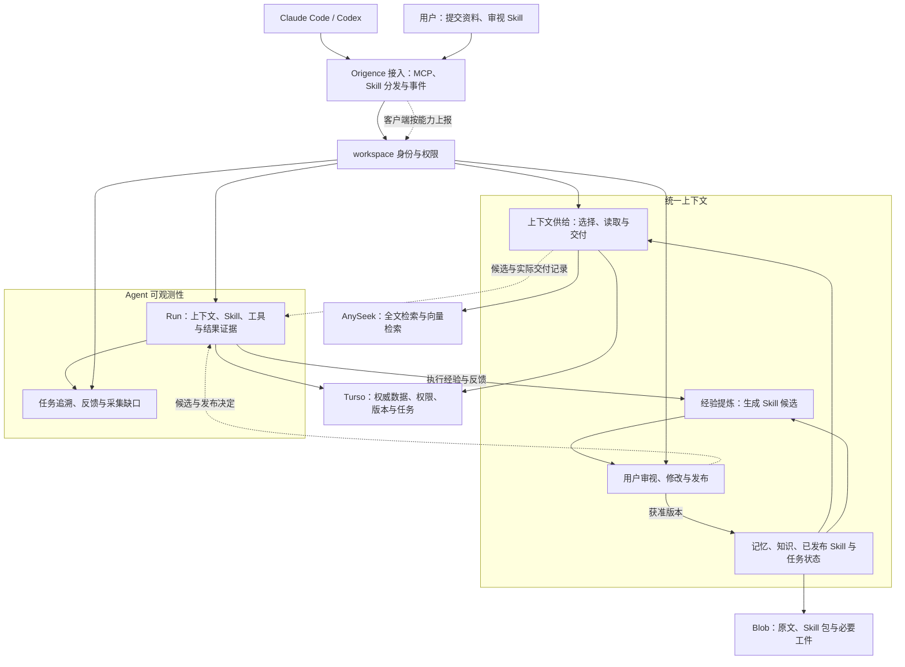

# Origence · 企业 Agent 数据底座架构规划

版本：v0.5 · 2026-11-16 · **精简评审稿，目标能力尚待实现**。

本文描述首版目标；当前实现见 [STATUS](../../STATUS.md)，已实现架构与接口分别见
[平台设计](2026-09-22-memory-knowledge-platform-design.md)和 [API](../../API.md)。
本版收敛首版能力，**全文与向量检索统一使用 AnySeek**。

## 1. 定位与首版范围

**Origence 是企业内部 Agent 的统一上下文数据底座：管理记忆、知识、Skill 与任务状态，
向 Agent 提供上下文，从执行经验沉淀可供用户审视的 Skill，并追溯任务结果。**

已确认：服务研发与业务团队，首批客户端为 **Claude Code 与 Codex**；记忆、知识、Skill 都属于上下文；
Skill 来自记忆和 Agent 执行经验，用户可以审视其内容与依据；AnySeek 同时承担全文和向量检索。

首版按三个职责形成闭环：

- **上下文管理与供给**：写入、检索、读取、版本与来源引用，按任务交付所需内容。
- **Skill 沉淀与复用**：从记忆和执行经验生成候选，供用户审视、修改、发布与复用。Skill 属于上下文。
- **最小可观测性**：关联本次任务获得的上下文、Skill、可观察工具和结果，并展示采集缺口。

## 2. 总体架构

这是目标图。实线表示业务调用或数据依赖，虚线表示观测证据流；事件接收和查询均校验权限。
客户端负责模型调用和工具执行，Origence 提供上下文、Skill 与证据管理。
全文与向量只有 AnySeek 一条目标检索路径，业务权威数据保留在 Turso，原始文件保留在 Blob。

## 3. 上下文包含什么

| 类型 | 管理内容 |
| --- | --- |
| 记忆 | 有主体、项目与适用条件的事实、偏好、已确认决策和经验 |
| 知识 | 企业文档、规范、接口定义、产品规则与授权业务资料 |
| Skill | 从记忆和 Agent 经历提炼的指令、步骤、流程、模板与参考资料 |
| 任务与会话状态 | 当前目标、约束、用户选择、相关会话摘要、进度与待办 |
| 环境与业务状态 | 相关代码/commit/差异、环境信息、工单或业务对象的观测状态 |
| 工具结果与交接 | 工具响应、测试结果、报告/文件工件与获准共享的交接信息 |

每类内容携带来源、版本或观测时间、有效范围和访问权限。首版通过显式写入、资料上传和客户端按需提交接入。
来源授权须覆盖共享范围；首批数据可限定在同权限 workspace 内。

**上下文资产**是平台可复用的内容，**本次任务上下文**是实际选取、交付或加载的子集。
按任务与预算选择内容，记录精确引用、缺失和裁剪；动态状态标明观测时间，过期时刷新或提示。
上下文交付清单记录本次提供了哪些版本，不声称外部业务系统在同一时刻保持事务一致。

MCP 读取与原生 Skill 加载是不同交付通道，分别记录交付和加载状态。
运行时只分发有效的已发布 Skill；候选进入专门的用户审视入口。

## 4. Skill 如何从经验沉淀

Agent 或平台从授权记忆和已记录的执行经历提炼目标、前提、参数、步骤、检查点与验证方法；
保留失败案例、适用限制和证据缺口。一次任务自报成功不能直接证明方法可靠。
候选生成可由用户触发；按项目启用自动生成候选的方式在实施时确定。

用户应能在可读的候选详情中审视：

| 内容 | 用户看到什么 |
| --- | --- |
| 方法 | 要解决什么问题、如何做、输入/输出、检查与验证步骤 |
| 依据 | 支持的记忆版本、运行记录、工具/结果和反馈，哪些部分尚未证实 |
| 边界 | 适用条件、失败/反例、尚未验证的情况 |
| 变化 | 相对已发布版本的内容差异、修改原因与审阅记录 |

用户可编辑、驳回候选，或作为新 Skill/新版本发布；已发布版本也可查看其依据与历史。
**建议默认由有发布权的用户确认后发布。** 批准绑定精确修订和发布范围，修改后重新审阅。
发布为不可变的 `SKILL.md`、manifest 和参考资料包，记录版本、摘要、支持来源与审阅决定，
再由两种客户端的适配器分发和加载。新经验形成后续候选，保留已发布版本的历史。

## 5. 最小可观测性

以 **Run** 关联任务输入、上下文交付清单、Skill 版本、工具事件、结果/反馈和采集覆盖。

| 证据来源 | 能记录什么 |
| --- | --- |
| Origence 服务端 | 搜索候选、实际交付内容/引用、Skill 分发版本、候选与发布决定 |
| 客户端适配器 | 按实际能力上报 Run 状态、Skill 加载、工具调用/结果与输出引用 |
| 用户或测试 | 任务反馈、结果工件与独立验证 |

每条事件保留运行身份、报告方、时间和稳定事件 ID，重复上报幂等处理。
候选、交付、加载、输出引用分别表达；Agent 自报结果与人工/测试验证分开。

**MCP 只能观测经过自身的请求。** 客户端未上报的活动标为未知或采集缺口。
首版提供可读的任务追溯详情，将上下文、Skill、工具与结果串起来。
默认保存引用、必要状态和脱敏摘要；凭据不进入上下文或观测记录。

## 6. Origence 与 AnySeek 分工

| 工作 | Origence | AnySeek |
| --- | --- | --- |
| 数据准备 | 接入资料、保留原文、解析/切块、生成查询与文档向量 | 保存文本、向量与检索 metadata，维护索引 |
| 检索 | 派生授权范围、发起全文/向量查询、复核来源与版本、组装引用 | 全文匹配、向量相似检索与候选排序 |
| 上下文与 Skill | 资产生命周期、经验提炼、用户审视、发布、交付与运行证据 | 提供获准内容的检索投影 |
| 持久化 | Turso 保存权威状态与持久任务，Blob 保存原始工件 | 按稳定记录身份写入、更新、删除及恢复索引 |

Origence 选择并固定 embedding 模型/profile 和维度，AnySeek 执行向量检索。
检索 metadata 携带完整 workspace、资产/来源版本和 generation；候选过滤与最终权威复核保持一致。
AnySeek 服务凭据由 Origence 持有，其 Tenant 隔离不替代 workspace 授权。
撤权或来源撤回先阻断后续读取/分发，再清理索引；快照和 Skill 不能绕过该规则。
依赖故障明确返回不可用，不伪装为空召回。

实现复用现有发布账本、单持久 Worker、原计划恢复和来源定位规则；外部模型/索引 IO 留在事务外。
检索统一完成时移除 Origence 中的 LanceDB 检索实现及无用依赖，构建配置一并更新。

## 7. 实施顺序与验收

| 顺序 | 要完成什么 | 验收结果 |
| --- | --- | --- |
| 1. 统一检索与双客户端接入 | 全文、向量都接 AnySeek，整理依赖；打通两客户端的授权搜索/读取 | 两种真实客户端能用两类检索读取有效资料并返回引用 |
| 2. Skill 经验沉淀 | 接入记忆/运行依据，生成候选，提供用户审视、修改和发布 | 研发/业务各一个 Skill 可追溯依据，由用户决定发布，并能在两客户端复用 |
| 3. 任务追溯闭环 | 固定上下文清单，关联 Skill、可观察工具、结果和反馈 | 真实任务可读地串联全过程证据，并显式显示未采集部分 |

Run 和结果记录随接入过程逐步补齐，供 Skill 提炼使用；第 3 步完成统一追溯体验。

每步同时核验：权限隔离、来源更新/撤回、精确版本引用、重复请求与重开恢复。
Skill 还需核验候选修改后批准失效、支持来源失效后的读取/分发行为。
检索替换通过公开库、HTTP/MCP 和实际 AnySeek 验证；客户端收益使用冻结任务比较，文档或协议 fixture 不代表真实任务通过。

**当前差距**：代码仍是可选 AnySeek 全文、LanceDB 向量；AnySeek 向量接入与 LanceDB 移除尚未实施。
既有 Bundle、SessionTurn、Feedback 和 Learning 可以复用；Skill 提炼/审视/发布、通用 Run 和两真实客户端验收仍待完成。
精确进度和历史证据分别保留在 [STATUS](../../STATUS.md)与 [VALIDATION](../../VALIDATION.md)。

## 8. 剩余待确认项

全文/向量统一 AnySeek、上下文层级、Skill 来源与用户审视已确认。其余建议默认值：

- 内网部署，先以 Claude Code/Codex 本地 CLI 为接入基线。
- Skill 默认经有发布权用户审阅后发布，候选生成方式按项目启用。
- 首批选择一个研发任务和一个业务任务，各从明确的数据与责任人开始。

确认后按第 7 节拆分实现合同。本文聚焦首版核心闭环，操作细节与既有领域合同仍在各自文档维护。
