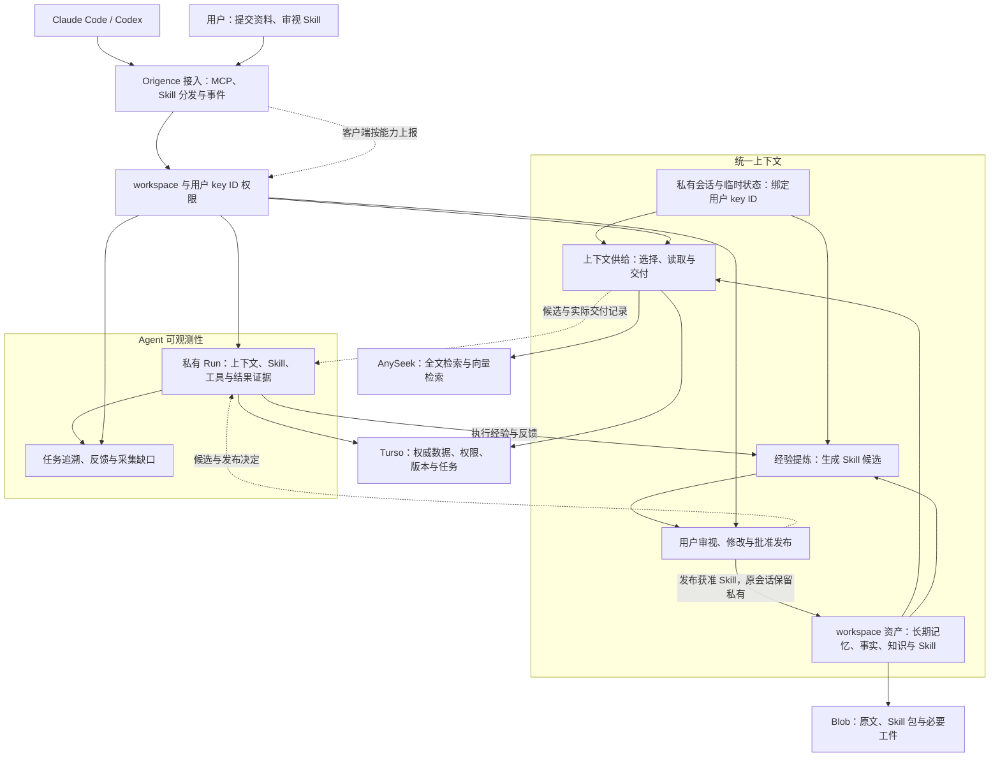
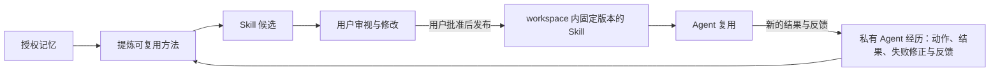

# Origence · 企业 Agent 数据底座架构规划

版本：v0.7 · 2026-11-16 · **首版关键决策已确认，目标能力尚待实现**。

本文描述首版目标；当前实现见 [STATUS](../../STATUS.md)，已实现架构与接口分别见
[平台设计](2026-09-22-memory-knowledge-platform-design.md)和 [API](../../API.md)。
本版收敛首版能力，**全文与向量检索统一使用 AnySeek**。
本稿的边界歧义与行业参考见[架构检视记录](../reviews/2026-11-16-agent-data-foundation-review.md)；其中建议尚未自动改写已确认决定。

## 1. 定位与首版范围

**Origence 是企业内部 Agent 的统一上下文数据底座：管理记忆、知识、Skill 与任务状态，
向 Agent 提供上下文，从执行经验沉淀可供用户审视的 Skill，并追溯任务结果。**

已确认：服务研发与业务团队，首批客户端为 **Claude Code 与 Codex**；记忆、知识、Skill 都属于上下文；
Skill 来自记忆和 Agent 执行经验，用户可以审视其内容与依据；AnySeek 同时承担全文和向量检索。
首版采用内网部署和两客户端本地 CLI；Skill 必须经有发布权的用户批准后发布；试点覆盖研发与业务两类。
会话与临时上下文私有，同一 workspace 内同一个用户 API key 绑定同一会话；
正式沉淀的长期记忆、事实、Skill 和知识归 workspace，在其中按权限复用，跨 workspace 隔离。

首版按三个职责形成闭环：

- **上下文管理与供给**：写入、检索、读取、版本与来源引用，按任务交付所需内容。
- **Skill 沉淀与复用**：从记忆和执行经验生成候选，供用户审视、修改、发布与复用。Skill 属于上下文。
- **最小可观测性**：关联本次任务获得的上下文、Skill、可观察工具和结果，并展示采集缺口。

## 2. 总体架构

这是目标图。实线表示业务调用或数据依赖，虚线表示观测证据流；事件接收和查询均校验权限。
客户端负责模型调用和工具执行，Origence 提供上下文、Skill 与证据管理。
全文与向量只有 AnySeek 一条目标检索路径，业务权威数据保留在 Turso，原始文件保留在 Blob。

## 3. 上下文包含什么

| 类型 | 管理内容 |
| --- | --- |
| 长期记忆与事实 | 有主体、项目与适用条件的事实、偏好、已确认决策和经验 |
| 知识 | 企业文档、规范、接口定义、产品规则与授权业务资料 |
| Skill | 从记忆和 Agent 经历提炼的指令、步骤、流程、模板与参考资料 |
| 任务与会话状态 | 当前目标、约束、用户选择、相关会话摘要、进度与待办 |
| 环境与业务状态 | 相关代码/commit/差异、环境信息、工单或业务对象的观测状态 |
| 工具结果与交接 | 工具响应、测试结果、报告/文件工件与获准共享的交接信息 |

每类内容携带来源、版本或观测时间、有效范围和访问权限。首版通过显式写入、资料上传和客户端按需提交接入。
来源授权须覆盖共享范围；首批数据可限定在同权限 workspace 内。

### 归属与隔离

| 层次 | 内容与访问边界 |
| --- | --- |
| 私有会话 | 原始会话、临时上下文、中间状态、工具原始结果、Run/快照与未发布候选；按用户 API key 隔离 |
| workspace 资产 | 正式沉淀的长期记忆、事实、知识与已发布 Skill；供同 workspace 的获授权用户/Agent 复用 |

同一 workspace 内，认证后的稳定 `key_id` 映射到唯一 `session_id`；密钥明文不作为存储身份。
同一 key 在 Claude Code/Codex 中继续同一会话，不同 key 的会话彼此隔离；需要独立会话的 Agent 使用不同 key。
同一会话可包含多个任务/Run。会话归属由服务端认证派生，传入其他 session ID 不能切换所有权。
workspace 成员身份不授予他人私有会话的读取权；所有私有入口、上下文组装与工件读取遵守同一边界。

从私有记录沉淀时显式生成 workspace 资产并确定共享正文，保留受控来源关联；原会话与轨迹继续私有。
记忆/事实/知识遵守相应写入与发布权限，Skill 还必须经过用户批准。未沉淀的候选不作为共享长期资产。
审阅者仅查看获准交付的候选与必要依据/脱敏摘要；共享资产或引用不自动开放原始会话。

**workspace 上下文资产**在空间内复用；**本次任务上下文**由选中的共享资产与当前 key 的私有会话/临时状态组成。
按任务与预算选择内容，记录精确引用、缺失和裁剪；动态状态标明观测时间，过期时刷新或提示。
上下文交付清单记录本次提供了哪些版本，不声称外部业务系统在同一时刻保持事务一致。

MCP 读取与原生 Skill 加载是不同交付通道，分别记录交付和加载状态。
运行时只分发有效的已发布 Skill；候选进入专门的用户审视入口。

## 4. Skill 如何从经验沉淀

Agent 或平台从授权记忆和已记录的执行经历提炼目标、前提、参数、步骤、检查点与验证方法；
保留失败案例、适用限制和证据缺口。一次任务自报成功不能直接证明方法可靠。
候选生成可由用户触发；按项目启用自动生成候选的方式在实施时确定。

用户应能在可读的候选详情中审视：

| 内容 | 用户看到什么 |
| --- | --- |
| 方法 | 要解决什么问题、如何做、输入/输出、检查与验证步骤 |
| 依据 | 支持的记忆版本、运行记录、工具/结果和反馈，哪些部分尚未证实 |
| 边界 | 适用条件、失败/反例、尚未验证的情况 |
| 变化 | 相对已发布版本的内容差异、修改原因与审阅记录 |

用户可编辑、驳回候选，或作为新 Skill/新版本发布；已发布版本也可查看其依据与历史。
候选继承输入的私有范围，审阅时明确交付必要内容；发布只共享获准的 Skill 正文与受控元数据。
**Skill 必须经有发布权的用户批准后发布。** 批准绑定精确修订和发布范围，修改后重新审阅。
发布为不可变的 `SKILL.md`、manifest 和参考资料包，记录版本、摘要、支持来源与审阅决定，
再由两种客户端的适配器分发和加载。新经验形成后续候选，保留已发布版本的历史。

## 5. 最小可观测性

以 **Run** 关联任务输入、上下文交付清单、Skill 版本、工具事件、结果/反馈和采集覆盖。
原始 Run 与轨迹沿用所属会话的 key 隔离；只有显式发布的结果/经验资产进入 workspace 共享范围。

| 证据来源 | 能记录什么 |
| --- | --- |
| Origence 服务端 | 搜索候选、实际交付内容/引用、Skill 分发版本、候选与发布决定 |
| 客户端适配器 | 按实际能力上报 Run 状态、Skill 加载、工具调用/结果与输出引用 |
| 用户或测试 | 任务反馈、结果工件与独立验证 |

每条事件保留运行身份、报告方、时间和稳定事件 ID，重复上报幂等处理。
候选、交付、加载、输出引用分别表达；Agent 自报结果与人工/测试验证分开。

**MCP 只能观测经过自身的请求。** 客户端未上报的活动标为未知或采集缺口。
首版提供可读的任务追溯详情，将上下文、Skill、工具与结果串起来。
默认保存引用、必要状态和脱敏摘要；凭据不进入上下文或观测记录。

## 6. Origence 与 AnySeek 分工

| 工作 | Origence | AnySeek |
| --- | --- | --- |
| 数据准备 | 接入资料、保留原文、解析/切块、生成查询与文档向量 | 保存文本、向量与检索 metadata，维护索引 |
| 检索 | 派生授权范围、发起全文/向量查询、复核来源与版本、组装引用 | 全文匹配、向量相似检索与候选排序 |
| 上下文与 Skill | 资产生命周期、经验提炼、用户审视、发布、交付与运行证据 | 提供获准内容的检索投影 |
| 持久化 | Turso 保存权威状态与持久任务，Blob 保存原始工件 | 按稳定记录身份写入、更新、删除及恢复索引 |

Origence 选择并固定 embedding 模型/profile 和维度，AnySeek 执行向量检索。
检索 metadata 携带完整 workspace、资产/来源版本和 generation；候选过滤与最终权威复核保持一致。
私有材料不默认进入 workspace 共享召回；检索/读取私有材料时额外复核 owner key 与 session，不能仅按 workspace 放行。
AnySeek 服务凭据由 Origence 持有，其 Tenant 隔离不替代 workspace 授权。
撤权或来源撤回先阻断后续读取/分发，再清理索引；快照和 Skill 不能绕过该规则。
依赖故障明确返回不可用，不伪装为空召回。

实现复用现有发布账本、单持久 Worker、原计划恢复和来源定位规则；外部模型/索引 IO 留在事务外。
检索统一完成时移除 Origence 中的 LanceDB 检索实现及无用依赖，构建配置一并更新。

## 7. 实施顺序与验收

| 顺序 | 要完成什么 | 验收结果 |
| --- | --- | --- |
| 1. 统一检索与双客户端接入 | 全文/向量接 AnySeek，落实 key→会话绑定与 workspace 资产隔离 | 同 key 跨客户端同会话、不同 key 私有隔离；两客户端可检索 workspace 资产并返回引用 |
| 2. Skill 经验沉淀 | 接入记忆/运行依据，生成候选，提供用户审视、修改和发布 | 研发/业务各一个 Skill 可追溯依据，经有发布权用户批准后发布，并能在两客户端复用 |
| 3. 任务追溯闭环 | 固定上下文清单，关联 Skill、可观察工具、结果和反馈 | 真实任务可读地串联全过程证据，并显式显示未采集部分 |

Run 和结果记录随接入过程逐步补齐，供 Skill 提炼使用；第 3 步完成统一追溯体验。

每步同时核验：权限隔离、来源更新/撤回、精确版本引用、重复请求与重开恢复。
跨 key 直接读取、Bundle/检索、Run 查询、工件和来源跳转均不能泄露私有内容；跨 workspace 不可共享资产。
Skill 还需核验候选修改后批准失效、支持来源失效后的读取/分发行为。
检索替换通过公开库、HTTP/MCP 和实际 AnySeek 验证；客户端收益使用冻结任务比较，文档或协议 fixture 不代表真实任务通过。

**当前差距**：代码仍是可选 AnySeek 全文、LanceDB 向量；AnySeek 向量接入与 LanceDB 移除尚未实施。
既有 Bundle、SessionTurn、Feedback 和 Learning 可以复用；Skill 提炼/审视/发布、通用 Run 和两真实客户端验收仍待完成。
当前 SessionTurn 仍按 workspace 和 writer 权限访问，尚无 key→唯一会话绑定，不满足本节目标私有边界。
精确进度和历史证据分别保留在 [STATUS](../../STATUS.md)与 [VALIDATION](../../VALIDATION.md)。

## 8. 已确认决定与试点准备

全文/向量统一 AnySeek、上下文层级与 Skill 经验沉淀方向已确认。本次进一步确认：

- **部署与接入**：内网部署，首版以 Claude Code/Codex 本地 CLI 为基线。
- **Skill 发布**：必须由有发布权用户批准；候选生成不等于发布。
- **试点方向**：覆盖研发与业务两类，具体任务、数据源和负责人在试点准备时落实。
- **数据归属**：同用户 API key 共用同一私有会话；长期记忆/事实/Skill/知识归 workspace，沉淀不公开原始会话。

按第 7 节拆分实现合同并推进；候选生成策略等操作细节随实现落实，既有领域合同仍在各自文档维护。
